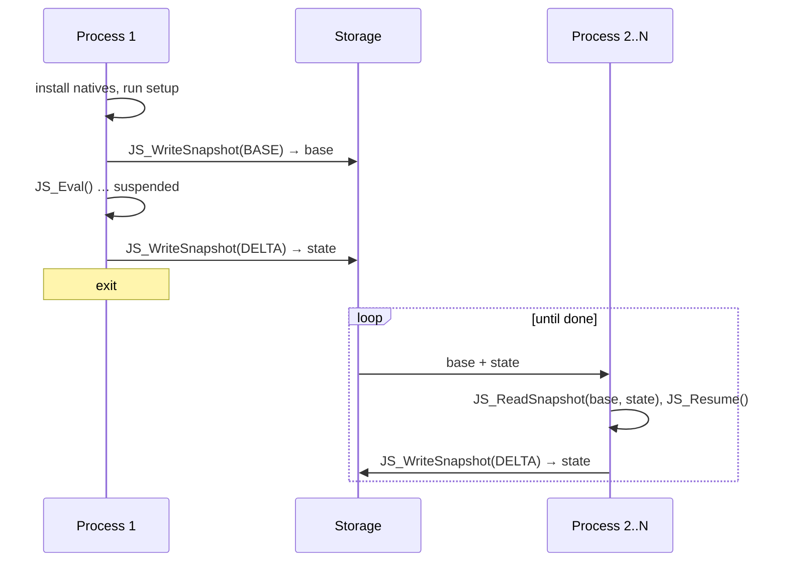

# dquickts

A fork of [QuickJS](https://bellard.org/quickjs/), Fabrice Bellard's small embeddable JavaScript
engine, that adds two things:

- **Durable execution.** You can pause a running program, even in the middle of a `for` loop,
  serialize its whole heap to bytes, and resume it later in a different process.
- **Native TypeScript.** `.ts` files run directly. The parser erases the types as it reads them,
  so there is no transpile step.

It also includes Rust bindings (a port of [rquickjs](https://github.com/DelSkayn/rquickjs)) that
expose both features.

```sh
git clone https://github.com/stencil-hq/dquickts
cd dquickts
make                 # builds qjs, qjsc and libquickjs.a
./qjs hello.ts
./qjs --drepl session.snap   # a REPL whose state survives restarts
make test-snapshot   # builds and runs the suspension and snapshot test hosts
```

## Contents

- [What this fork adds](#what-this-fork-adds)
- [Durable REPL](#durable-repl)
- [Snapshots](#snapshots)
  - [What a snapshot is](#what-a-snapshot-is)
  - [When you can take one](#when-you-can-take-one)
  - [Example: hibernating in the middle of a loop](#example-hibernating-in-the-middle-of-a-loop)
  - [Durable host calls](#durable-host-calls)
  - [Incremental snapshots](#incremental-snapshots)
  - [How it works](#how-it-works)
  - [The host's side of the contract](#the-hosts-side-of-the-contract)
  - [Limitations](#limitations)
- [TypeScript](#typescript)
- [Rust bindings](#rust-bindings)
- [Testing](#testing)
- [Documentation](#documentation)
- [Credits and license](#credits-and-license)

## What this fork adds

This fork tracks upstream QuickJS `2026-06-04` (see `VERSION`). Everything upstream ships,
including the experimental Temporal and Intl support (`qjs --experimental`), is still here. The
fork adds:

| Feature | API |
| --- | --- |
| In-process suspension of running code | `JS_RequestSuspend()`, `JS_IsSuspended()`, `JS_Resume()`, `JS_GetProgramBranchCount()` |
| Durable host calls: a C function parks its JS caller until the host supplies a result | `JS_SuspendCall()`, `JS_ResumeWith()` |
| Heap snapshots of a whole runtime, including a suspended call stack | `JS_WriteSnapshot()`, `JS_ReadSnapshot()` |
| Incremental snapshots: a delta holds only what changed since a base | `JS_SNAPSHOT_BASE`, `JS_SNAPSHOT_DELTA`, `JS_DropSnapshotBase()` |
| TypeScript: types erased at parse time; enums, namespaces and parameter properties compiled to bytecode | `JS_EVAL_FLAG_TYPESCRIPT`, `qjs --typescript`, `.ts`/`.mts`/`.cts` |
| Standard decorators (2023-05), auto-accessors, `Symbol.metadata`; TypeScript legacy decorators and decorator metadata | `JS_EVAL_FLAG_TS_LEGACY_DECORATORS`, `JS_EVAL_FLAG_TS_DECORATOR_METADATA` |
| Explicit resource management (ES2026) | `using`, `await using`, `DisposableStack`, `AsyncDisposableStack` |
| Ports from [quickjs-ng](https://github.com/quickjs-ng/quickjs) | `queueMicrotask()`, `atob()`/`btoa()`, `DOMException`, the V8 stack trace API, promise hooks, immutable `ArrayBuffer`s, `performance`, `os.setInterval()`, `std.writeFile()`, the `bjson` module, a re-entrant event loop, C closures, private symbols, runtime dump flags, and bug fixes |
| Embedder helpers | `JS_IsEqual()`, `JS_NewProxy()`, `JS_GetProxyTarget()`, `JS_PromiseMarkAsHandled()`, and others |
| A REPL whose functions and variables survive restarts | `qjs --drepl FILE` |
| Rust bindings built on this engine | [`rquickjs/`](rquickjs/README.md) |

The full list is under `unreleased` in [`Changelog`](Changelog).

## Durable REPL


`qjs --drepl FILE` starts the usual REPL, with highlighting, history and tab completion, and
input is TypeScript. After every command, the whole session is saved to `FILE`. When you start
`qjs --drepl FILE` again, the session comes back with the same functions, variables, objects and
closures:

```text
$ ./qjs --drepl session.snap
QuickJS - Type "\h" for help
Created the durable session session.snap
qjs> function add(a: number, b: number): number { return a + b }
undefined
qjs> let total: number = add(2, 3)
undefined
qjs> class Counter { constructor(private n = 0) {} inc(): number { return ++this.n } }
undefined
qjs> const c = new Counter()
undefined
qjs> c.inc()
1
qjs> ^C
(Press Ctrl-C again to quit)
qjs> ^C
$ ./qjs --drepl session.snap
QuickJS - Type "\h" for help
Restored the durable session session.snap
qjs> add(total, 10)
15
qjs> c.inc()
2
```

The commands don't run in the REPL's own runtime. They run in a separate runtime that holds only
the standard objects plus `print()` and `console.log()`:

- The line editor (`repl.js`) stays in the main runtime and passes each command to the durable
  runtime. The durable runtime runs the command and its promise jobs, so top-level `await` works,
  and sends back the rendered result.
- After each command, the durable runtime is written with `JS_WriteSnapshot()` as a delta of a
  new session. It goes to a temporary file that is then renamed over `FILE`, so the file always
  holds a complete delta. The session in the transcript above takes about 400 bytes.
- At startup, `qjs` rebuilds the base, which is a new session with every lazily created builtin
  already instantiated. [Bases are reproducible](#incremental-snapshots), so this rebuilt base is
  byte-identical to the one the deltas were written against. `JS_ReadSnapshot()` then applies
  `FILE` on top of it. If the file is missing, a new session starts.

Limits:

- The `std` and `os` modules are not available. Their files, timers and handlers are host state
  that a snapshot cannot save.
- `\load file` evaluates a file inside the session.
- Ctrl-C interrupts a running command. The session is not affected.
- A session file only loads into the `qjs` build that wrote it.
- Tab completion lists properties of the global object. Like the regular REPL, it does not list
  top-level `let`, `const` and `class` names, but it does complete their members (`c.in` →
  `c.inc()`).

## Snapshots

### What a snapshot is

A snapshot is the entire state of a JavaScript runtime, written out as one byte buffer. It
includes:

- every context (realm), with its global object and its intrinsics,
- every object, closure, string, symbol and compiled function,
- pending promise jobs, paused generators, and async functions waiting on an `await`,
- loaded modules, with their bindings and evaluation state (a module can be saved in the middle
  of a top-level `await`),
- the call stack of the synchronous code that was running, if the runtime is currently suspended.

To restore, you read the snapshot into a fresh, empty runtime. You get the same program in the
same state:

- objects keep their identity, so two references to one object still point to one object,
- closures still share their captured variables,
- pending work is still pending.

The snapshot holds indexes instead of pointers. That means the rebuilt heap can live at any
address, in any process, on any machine that runs the same build of the engine.

Some things you can do with this:

- **Hibernate.** Write an idle or long-running script to disk, free its memory, and bring it
  back when there is work for it.
- **Durable workflows.** A script calls a host function whose answer arrives hours later. The
  process saves the script and exits. A later process loads it and finishes the call (see
  [durable host calls](#durable-host-calls)).
- **Time slicing across machines.** Run a computation in slices, with each slice in whichever
  worker is free.
- **Warm starts.** Run your setup once, snapshot the result, and start every new instance from
  that snapshot instead of running the setup again.

### When you can take one

You can only take a snapshot when no JavaScript is running on the C stack. There are two ways to
get to that point.

1. **Between jobs.** The script has returned, and the host is not running any job. Async code
   reaches this state on its own at every `await`. A waiting async function, a yielded
   generator and a pending promise are all ordinary heap objects at that point, so you can
   snapshot right away.
2. **While suspended.** This covers synchronous code. A long loop never yields, so you ask the
   engine to stop it:
   1. Call `JS_RequestSuspend()`, usually from the interrupt handler.
   2. At the next *safepoint* (described under [How it works](#how-it-works)), the engine moves
      the running frames to the heap and unwinds the C stack.
   3. The call that started the execution, such as `JS_Eval()` or `JS_Call()`, returns
      `JS_EXCEPTION`, and `JS_IsSuspended()` returns true.
   4. Take the snapshot now. Later, in the same runtime or in a restored one, `JS_Resume()`
      continues from the exact instruction where the code stopped.

### Example: hibernating in the middle of a loop

```c
#include <stdio.h>
#include <string.h>
#include "quickjs.h"

static JSValue js_print(JSContext *ctx, JSValueConst this_val,
                        int argc, JSValueConst *argv)
{
    const char *str = JS_ToCString(ctx, argv[0]);
    if (!str)
        return JS_EXCEPTION;
    puts(str);
    JS_FreeCString(ctx, str);
    return JS_UNDEFINED;
}

/* Every C pointer the heap can hold. Same list, same order, when reading. */
static const void * const natives[] = { (const void *)js_print };
static const JSSnapshotHost host = { .natives = natives, .native_count = 1 };

static int on_interrupt(JSRuntime *rt, void *opaque)
{
    JS_RequestSuspend(rt); /* suspend at the next safepoint */
    return 0;
}

int main(void)
{
    const char *src =
        "let sum = 0;\n"
        "for (let i = 0; i < 1e6; i++) sum += i;\n"
        "print(`sum = ${sum}`);\n"
        "sum\n";
    JSRuntime *rt = JS_NewRuntime();
    JSContext *ctx = JS_NewContext(rt);
    JSValue global = JS_GetGlobalObject(ctx), val;
    JS_SetPropertyStr(ctx, global, "print",
                      JS_NewCFunction(ctx, js_print, "print", 1));
    JS_FreeValue(ctx, global);

    JS_SetInterruptHandler(rt, on_interrupt, NULL);
    val = JS_Eval(ctx, src, strlen(src), "<loop>", JS_EVAL_TYPE_GLOBAL);
    if (JS_IsException(val) && JS_IsSuspended(rt)) {
        /* Stopped in the middle of the loop: save the whole runtime. */
        size_t len;
        uint8_t *snap = JS_WriteSnapshot(ctx, &len, &host, NULL, 0, 0);
        printf("suspended, snapshot = %zu bytes\n", len);

        /* Rebuild it in a fresh runtime (could be another process, later). */
        JSRuntime *rt2 = JS_NewRuntime();
        JSSnapshotResult res;
        char err[128];
        if (JS_ReadSnapshot(rt2, snap, len, NULL, 0, &host, &res,
                            err, sizeof(err))) {
            fprintf(stderr, "restore failed: %s\n", err);
            return 1;
        }
        js_free(ctx, snap);
        JS_FreeContext(ctx);
        JS_FreeRuntime(rt); /* the original runtime is gone */

        rt = rt2;
        ctx = res.contexts[0];
        JS_FreeSnapshotResult(rt, &res);
        val = JS_Resume(ctx); /* continues inside the for loop */
    }
    /* prints "sum = 499999500000" */
    JS_FreeValue(ctx, val);
    JS_FreeContext(ctx);
    JS_FreeRuntime(rt);
    return 0;
}
```

```sh
$ cc -I. example.c libquickjs.a -lm -lpthread -o example && ./example
suspended, snapshot = 13185 bytes
sum = 499999500000
```

The restored runtime has no interrupt handler, so the loop runs to the end. For a version where
each slice runs in a new process, see
[`tests/snapshot/hibernate.c`](tests/snapshot/hibernate.c) and
[`tests/snapshot/cross_process.sh`](tests/snapshot/cross_process.sh).

### Durable host calls

A C function can suspend the JavaScript code that called it. The function returns
`JS_SuspendCall()`. The JS call then stays open until the host completes it with
`JS_ResumeWith()`, which can happen after a snapshot and in another process:

```c
/* fetch(url): the script waits; the host completes the call later. */
static JSValue js_fetch(JSContext *ctx, JSValueConst this_val,
                        int argc, JSValueConst *argv)
{
    /* record argv[0] somewhere durable, e.g. pass it as a snapshot root */
    return JS_SuspendCall(ctx);
}

/* ...snapshot, exit, restore in another process, then: */
val = JS_ResumeWith(ctx, JS_NewString(ctx, body), /* throw_flag */ 0);
```

From the script's side, `const body = fetch(url)` is an ordinary synchronous call. If you pass
`throw_flag = 1`, the call throws the value instead of returning it. The caller has to call the
C function directly, from a stack that can be suspended. If it doesn't, `JS_SuspendCall()`
throws a `TypeError`.

### Incremental snapshots

A full snapshot of even an empty runtime is about 13 KB, because the realm's intrinsics are part
of the heap. Incremental snapshots avoid writing those bytes over and over:

1. Write one snapshot with `JS_SNAPSHOT_BASE`. A good moment is after the host natives are
   installed and the application script has run. This full snapshot becomes the runtime's
   *base*.
2. Write later snapshots with `JS_SNAPSHOT_DELTA`. A delta holds only the cells (objects, closure
   variables, frames, and so on) that were created or modified since the base, plus their new
   strings and atoms, plus the roots. A modified object is saved as a patch of its base version,
   so adding or setting a property costs a few bytes.
3. To restore, call `JS_ReadSnapshot(rt, base, base_len, delta, delta_len, ...)`.

Deltas are not chained: each delta needs only the base. A runtime restored from a base has that
base attached, so the deltas it writes are relative to the same base. Many runtimes can share
one base.

Bases are reproducible. Runtimes of the same engine build that are set up the same way (same host
natives, same code run) write byte-identical bases, in any process. So a host doesn't have to
store the base: it can rebuild it and keep only the deltas. `qjs --drepl` works this way. The
`Math.random()` state is not part of a base. Full snapshots and deltas save it, and a base read
without a delta starts with a fresh seed.



These sizes come from `tests/snapshot/cross_process.sh`. Each slice runs in a new process. The
base (12,931 bytes) is taken *before* the script runs, so every delta also carries the script's
compiled code and all of its data:

| Script | Processes | Largest delta (bytes) |
| --- | ---: | ---: |
| `hibernate-sync.js` | 365 | 19,915 |
| `control-async.js` | 92 | 18,722 |
| `control-generators.js` | 82 | 17,696 |
| `data-map.js` | 5 | 14,715 |
| `control-using.js` | 66 | 7,536 |

If you take the base after setup instead, the deltas shrink to the size of the change. In the
[Rust example](#rust-bindings), the base is 13,403 bytes and the delta after one function call is
128 bytes.

While a base is attached, the runtime keeps every cell, string and atom of the base alive, so
that they keep their identity. They are not garbage collected, and weak references to them never
become empty. `JS_DropSnapshotBase()` releases them. After that, the next delta needs a new base.

### How it works

The implementation is in `quickjs-snapshot.c` (format, writer, reader, frames),
`quickjs-snapshot-data.c` (collections, weak containers, buffers, typed arrays) and
`quickjs-snapshot-control.c` (generators, promises, iterators, Proxy, disposable stacks,
modules). `quickjs.c` `#include`s all three, so embedders compile nothing extra.

**Suspension.** QuickJS already polls an interrupt counter at backward and conditional branches.
The counter fires every 10,000 branches by default (`JS_INTERRUPT_COUNTER_INIT`). When a
suspension is pending and the counter fires, the engine checks whether the whole call stack is
suspendable. That holds when:

- every frame is a plain JS function (not a generator and not async),
- the outermost frame was called by the host through `JS_Eval()`, `JS_Call()` or a similar entry
  point,
- every other frame was called by the frame below it through a plain call, method call, `new`,
  spread call, tail call or bound function.

If the check passes, each frame (its bytecode position, operand stack, arguments and locals) is
moved into a heap frame object. That is the same structure an async function uses to survive an
`await`. The C stack then unwinds. Closures that captured a frame's variables keep pointing at
the moved frame.

If any frame was entered on behalf of native code, the request stays pending until a later
safepoint. That includes getters and setters, `valueOf`/`toString` conversions, Proxy traps,
`forEach`/`JSON.stringify` callbacks, `eval` code and promise jobs. Because of this rule, the
engine never has to save a C stack.

`JS_GetProgramBranchCount(ctx)` returns the number of backward and conditional branches executed in
`ctx`. It increments unconditionally at every safepoint and is not saved in snapshots (a restored
context starts at zero), so summing it across hibernated slices equals an uninterrupted run.

**Writing.** The writer walks the heap from the roots:

- the context list,
- the job queue,
- the host's `roots[]`,
- the suspended frame chain, if there is one.

Each object it reaches becomes a *cell* with an index. A reference to a cell is written as a
LEB128 index, which is how shared objects and cycles come out right. Atoms and strings go into
their own tables. Predefined atoms are never written. Shapes (hidden classes) are not written
either: each object stores its prototype and its property list, and the reader rebuilds the
shape. The output is laid out as follows:

| Section | Contents |
| --- | --- |
| Header | magic `QJSSNAP\n`, format version, full/delta, base id (FNV-1a-64 of the base), build signature, host class names |
| Cell headers | type and allocation size of every cell |
| Changed cells | delta only: indexes of base cells whose body changed |
| Atoms, strings | the ones the base does not already have |
| Roots | contexts, jobs, host roots, suspended frame |
| Bodies | one length-prefixed body per cell (index-prefixed in a delta) |

**Native code pointers.** The heap holds C pointers: builtin functions, job functions, lazily
created builtins, and host functions. Each one is written as an index into a registry. The
registry is built in a fixed order: the engine's builtin function lists and natives first, then
the host's `natives[]` and `func_lists[]`. A pointer that is not in the registry fails the write
with `snapshot: unregistered native code pointer`.

The header also carries a hash of the registry's layout: engine version, format and bytecode
versions, `sizeof(JSValue)`, builtin names, and the native counts. `JS_ReadSnapshot()` rejects a
snapshot when the hash differs.

**Reading.**

1. The reader allocates an empty shell for every cell from the cell headers, before it reads any
   body. Because every cell already exists, bodies can refer to each other in any order, and
   cycles need no special handling.
2. It fills the bodies:
   - Contexts get back their saved intrinsics. Nothing is created from scratch.
   - Bytecode goes back through the regular bytecode reader (`JS_ReadFunctionHeader()` /
     `JS_ReadFunctionBody()`).
   - Frames are checked against their function's layout.
3. It runs fixups, restores object flags, and calls the host's `load_opaque()` for each host
   object.

The reader rejects bad magic, wrong versions, a delta from a different base, a registry or class
mismatch, truncation, duplicate or missing bodies, and trailing bytes. If it fails partway, it
turns half-built objects back into plain ones so that no finalizer runs on garbage. You then
free the runtime.

**Deltas.** Deltas use byte comparison, not dirty bits. While a base is attached, the runtime
keeps the encoded body of every base cell. A delta write serializes every reachable cell and
every base cell, then compares each base cell's bytes with the stored body. Only bodies that
differ, and new cells, go into the delta.

A changed body is written as a patch whenever that is shorter. The patch records how long a
prefix and suffix the body shares with its base body, plus the bytes in between. An object body
ends its property list with a terminator instead of starting it with a count. So adding,
setting or deleting one property changes only a few bytes in the middle. A change to a global
object with a hundred properties costs about twenty bytes.

The `Math.random()` state lives in the roots of full snapshots and deltas, not in the context
cell. That is why a base doesn't depend on the seed.

Base cells are walked even when nothing reaches them anymore, because a reachable object can
still change them, for example by detaching an `ArrayBuffer` they share. Base cells keep their
indexes, and new cells are numbered after them. To apply a delta, the reader loads the base,
skips the bodies of changed cells, and reads those bodies from the delta.

**Weak references.** A `WeakRef` or `WeakMap` entry whose target has already been collected is
written as dead and restored as dead. A `FinalizationRegistry` entry whose target is dead still
gets its cleanup callback after the restore. Objects that are only weakly reachable are freed by
the restored runtime.

### The host's side of the contract

- **Natives.** List every C function the heap can reference: functions given to
  `JS_NewCFunction*()`, `JSCFunctionData` callbacks, job functions and C module init functions.
  Also list the function lists you gave to `JS_SetPropertyFunctionList()`. Use the same list in
  the same order when writing and when reading. A change in the number of natives is detected,
  but swapping two natives is not.
- **Host classes.** Register the same classes with the same class IDs before reading. Objects
  that carry opaque data need the `save_opaque()` hook (to describe the data as a JS value) and
  the `load_opaque()` hook (to rebuild it with `JS_SetOpaque()`).
- **Host-held values.** Values the host keeps outside the heap are not in the snapshot. Pass them
  as `roots`. `JS_ReadSnapshot()` returns them in the same order.
- **Runtime configuration.** None of the runtime's configuration is saved. Set these again after
  a restore: the interrupt handler, module loader, memory and stack limits, promise rejection
  tracker, context opaque pointers, and locale callbacks. Modules imported after the restore go
  through the new runtime's loader.
- **Buffers.** `ArrayBuffer` data is always restored into memory the engine owns. Host buffers
  are copied, and their free functions are not kept.

### Limitations

- `JS_WriteSnapshot()` throws a `TypeError` for:
  - contexts with the Intl or Temporal intrinsics,
  - `SharedArrayBuffer`s whose memory may be shared with another thread,
  - host-class objects with opaque data when there is no `save_opaque()` hook,
  - C closures (`JS_NewCClosure()`), whose opaque pointer is host state,
  - any call made while JS code is running on the C stack.
- A runtime can have only one suspended execution at a time.
- If a suspended frame cannot be resumed (stack overflow, or the interrupt handler interrupts
  it), it and its callees are terminated without running `catch`/`finally` blocks or `using`
  disposals. The error is thrown at the frame's call site.
- A snapshot only loads into the same engine build: same version, same native registry, same
  word size.
- Snapshots are trusted input, like bytecode. Truncated or mismatched snapshots are rejected,
  but malicious ones are not detected.
- Clocks keep running. `Date.now()` reflects the time spent hibernated, and local-time methods
  use the timezone of the process that restored the snapshot. `performance.now()` does not: it
  continues from its value when the snapshot was written.

## TypeScript

You don't need `tsc`, esbuild or a bundler. The parser recognizes TypeScript syntax and erases
the types while parsing, so it generates no bytecode for them. Constructs that do something at
run time (enums, namespaces, parameter properties, decorators) compile straight to ordinary
bytecode. The semantics follow `tsc` with `isolatedModules` and `useDefineForClassFields`. Since
the output is regular bytecode, TypeScript programs snapshot exactly like JavaScript ones.

```ts
// greet.ts
enum Level { Info, Warn = "warn" }
const enum Flags { A = 1, B = A << 1 }          // folded to constants
namespace Util { export const twice = (n: number): number => n * 2; }
interface User { name: string; age?: number }

class Greeter {
  constructor(private readonly prefix: string) {}  // parameter property
  greet<T extends User>(u: T): string { return `${this.prefix} ${u.name}`; }
}

function logged(target: any, ctx: ClassMethodDecoratorContext) {
  return function (this: any, ...args: any[]) {
    print(`call ${String(ctx.name)}`);
    return target.apply(this, args);
  };
}
class Svc { @logged run(n: number) { return Util.twice(n) + Flags.B; } }

print(new Greeter("hi").greet({ name: "ts" } satisfies User), Level[0], Level.Warn, new Svc().run(3));
```

```sh
$ ./qjs greet.ts
call run
hi ts Info warn 8
```

**How code gets treated as TypeScript.**

- `qjs`, `qjsc` and the `quickjs-libc` module loader treat `.ts`, `.mts` (module) and `.cts`
  (script) files as TypeScript.
- `qjs --typescript` does the same for `-e`, for stdin (`-`) and for REPL commands. With
  `qjs --drepl`, REPL input is always TypeScript.
- From C, pass `JS_EVAL_FLAG_TYPESCRIPT` to `JS_Eval()`.
- From JS, use `std.evalScript(src, { typescript: true })`.
- Direct `eval()` and `Function()` bodies are always JavaScript.

**Imports** resolve the way TypeScript projects expect. If `./x.js` or `./x` doesn't exist,
`./x.ts` is used, and `./x.mjs` falls back to `./x.mts`. Imports used only as types are dropped,
and so is `export { T }` when `T` is a type.

**What's supported.**

- The full TypeScript 5 type syntax: annotations, generics (with `const`/`in`/`out`), `as`,
  `as const`, `satisfies`, `!`, `<T>x`, overloads, `abstract`, accessibility modifiers,
  `readonly`, `override`, `declare`, index signatures, `import type` / `export type`, and the
  ambiguous cases resolved the way `tsc` resolves them, such as `f<T>(x)` and arrow functions
  with return types.
- **Enums** compile the way `tsc` compiles them, including reverse mappings and merged
  declarations. Constant initializers are evaluated at compile time.
- **`const enum`** members are folded to constants within the compilation unit. The enum object
  is still emitted, so dynamic accesses and exports keep working.
- **Namespaces** support dotted names, merging, and `import X = N.Y` aliases.
- **Decorators** are the standard ones by default. For `tsc`-style legacy decorators use
  `qjs --experimental-decorators` (`JS_EVAL_FLAG_TS_LEGACY_DECORATORS`). To also emit
  `design:type`, `design:paramtypes` and `design:returntype` metadata, use
  `--emit-decorator-metadata` (`JS_EVAL_FLAG_TS_DECORATOR_METADATA`).

**Limitations.**

- There is no type checking.
- JSX/TSX, `export =` and `import x = require()` are rejected with a `SyntaxError`.
- As with `isolatedModules`, re-exporting an imported type needs `export type`, and const enums
  from other modules are accessed as objects.
- Code that relies on `useDefineForClassFields: false` behaves differently.

The full reference is the TypeScript section of [`doc/quickjs.texi`](doc/quickjs.texi).

## Rust bindings

[`rquickjs/`](rquickjs/README.md) contains rquickjs 0.14.0, vendored and ported to this engine.
`rquickjs-sys` compiles the QuickJS sources two directories above it. On top of upstream
rquickjs it adds:

- **`Runtime::suspender()`** returns a `Suspender` that you can trigger from any thread or from
  the interrupt handler. The suspended call returns `Error::Suspended`, and `Ctx::resume()`
  continues it.
- **`Ctx::write_snapshot()` and `Runtime::read_snapshot()`** write and read full, base or delta
  snapshots. A `SnapshotHost` registers the Rust functions and classes that a snapshot can
  reference. Class instances are saved through the `Persist` trait.
- **`SnapshotHost::builtins()`** gives scripts `snapshot()` and `restore(state, value)`, which
  work like `setjmp()`/`longjmp()` for the whole runtime.
- **TypeScript**: `EvalOptions::typescript`, or files named `*.ts`/`*.mts`/`*.cts`. Set the
  decorator flavor with `Runtime::set_decorators()`.

```toml
[dependencies]
rquickjs = { git = "https://github.com/stencil-hq/dquickts" }
```

```rust
use rquickjs::{snapshot::{SnapshotHost, SnapshotKind}, Context, Function, Runtime};

let host = SnapshotHost::new().function("add", |ctx| {
    Function::new(ctx.clone(), |a: i32, b: i32| a + b)?.with_name("add")
});

let rt = Runtime::new()?;
let ctx = Context::full(&rt)?;
let base = ctx.with(|ctx| {
    let natives = host.natives(&ctx)?;
    ctx.globals().set("add", natives.function("add")?)?;
    ctx.eval::<(), _>("var total = 0; function step(n) { total = add(total, n); return total; }")?;
    ctx.write_snapshot(&host, SnapshotKind::Base, &[])
})?;                                   // 13,403 bytes
let delta = ctx.with(|ctx| {
    ctx.eval::<i32, _>("step(2)")?;
    ctx.write_snapshot(&host, SnapshotKind::Delta, &[])
})?;                                   // 128 bytes

// later, in another runtime or process
let rt = Runtime::new()?;
let restored = rt.read_snapshot(&host, &base, Some(&delta))?;
let total: i32 = restored.contexts[0].with(|ctx| ctx.eval("step(3)"))?;
assert_eq!(total, 5);
```

The crates are not published to crates.io. The rquickjs [README](rquickjs/README.md) lists what
was removed (QuickJS-NG-only APIs) and the supported targets.

## Testing

```sh
make test                         # upstream tests, plus TypeScript, decorators and `using`
make test-snapshot                # suspension and snapshot hosts (tests/snapshot)
make -C tests/snapshot ASAN=1 check   # the same, under AddressSanitizer and UBSan
make -C tests/snapshot stress     # suspend every 97 branches across the upstream test suite
make test2-bootstrap && make test2    # test262
(cd rquickjs && cargo test)       # Rust bindings
```

`tests/snapshot` contains these hosts:

| Host | What it checks |
| --- | --- |
| `test_suspend` | suspends at every call and resumes until done; checks that output matches an uninterrupted run, that no suspension happens in non-suspendable regions, and that GC can run while suspended |
| `test_snapshot_api` | the native registry, host classes, host roots, multiple realms, deltas, `JS_SuspendCall()`, and error handling |
| `test_snapshot` | snapshots, frees and rebuilds the runtime at every job boundary (full and delta) |
| `test_hibernate` | suspends from the interrupt handler, then snapshots and rebuilds mid-execution, on `js/` and on the upstream tests |
| `cross_process.sh` | checks that running each slice in a fresh process gives the same output as one uninterrupted run |

## Documentation

- [`quickjs.h`](quickjs.h): the *Suspension* and *Heap snapshots* comment blocks are the API
  reference.
- [`doc/quickjs.texi`](doc/quickjs.texi): the full manual, including suspension, snapshots,
  TypeScript, decorators, resource management and stack traces. `make build_doc` builds the HTML
  and PDF versions.
- [`Changelog`](Changelog): everything added since upstream `2026-06-04`.
- [`rquickjs/README.md`](rquickjs/README.md): the Rust bindings.

## Credits and license

dquickts is based on QuickJS by Fabrice Bellard and Charlie Gordon. It includes code ported from
[quickjs-ng](https://github.com/quickjs-ng/quickjs), and its Rust bindings are derived from
[rquickjs](https://github.com/DelSkayn/rquickjs). Everything is under the MIT license; see
[`LICENSE`](LICENSE) and [`rquickjs/LICENSE`](rquickjs/LICENSE).
