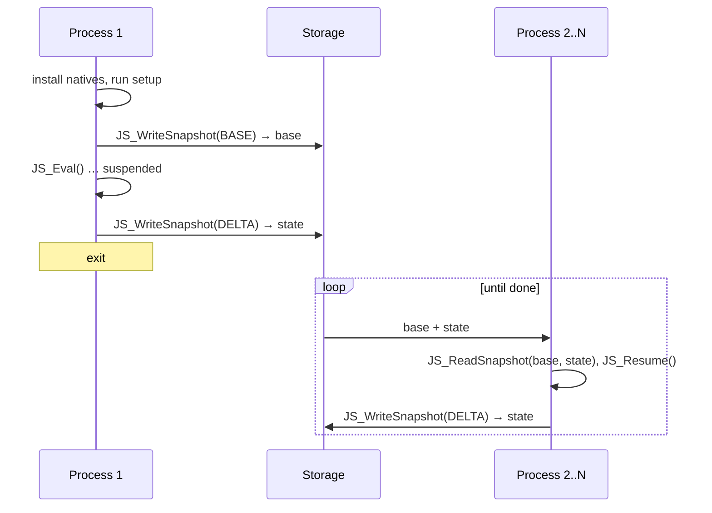

# dquickts

A fork of [QuickJS](https://bellard.org/quickjs/), Fabrice Bellard's small embeddable JavaScript
engine, that adds three things:

- **Durable execution.** You can pause a running program, even in the middle of a `for` loop,
  serialize its whole heap to bytes, and resume it later in a different process.
- **Native TypeScript.** `.ts` files run directly. The parser erases the types as it reads them,
  so there is no transpile step.
- **Python 3.15.** Python is compiled to QuickJS bytecode and runs on the same VM, heap and GC
  as JS, with objects shared between the two languages. A CPython-compatible C API loads
  extension modules: pip, abi3 wheels, and source builds of numpy, Pillow and matplotlib.

It also includes Rust bindings (a port of [rquickjs](https://github.com/DelSkayn/rquickjs)) that
expose all three.

```sh
git clone https://github.com/stencil-hq/dquickts
cd dquickts
make                 # builds qjs, qjsc, qpy and libquickjs.a
./qjs hello.ts
./qpy hello.py               # Python, with CPython's command line
./qjs                        # the REPL: JS, or Python after \py (\js switches back)
./qjs --drepl session.snap   # a REPL whose state survives restarts
./qjs --drepl py.snap --python   # the same for Python and JS together
make test-snapshot   # builds and runs the suspension and snapshot test hosts
```

## Contents

- [What this fork adds](#what-this-fork-adds)
- [Durable REPL](#durable-repl)
  - [Python sessions](#python-sessions)
  - [JS and Python in one REPL](#js-and-python-in-one-repl)
- [Snapshots](#snapshots)
  - [What a snapshot is](#what-a-snapshot-is)
  - [When you can take one](#when-you-can-take-one)
  - [Example: hibernating in the middle of a loop](#example-hibernating-in-the-middle-of-a-loop)
  - [Durable host calls](#durable-host-calls)
  - [Incremental snapshots](#incremental-snapshots)
  - [How it works](#how-it-works)
  - [The host's side of the contract](#the-hosts-side-of-the-contract)
  - [Limitations](#limitations)
- [TypeScript](#typescript)
- [Python](#python)
  - [JS and Python together](#js-and-python-together)
  - [Embedding Python in C](#embedding-python-in-c)
  - [C API and extension modules](#c-api-and-extension-modules)
  - [Runtime features](#runtime-features)
  - [Known deviations](#known-deviations)
  - [Testing Python](#testing-python)
- [Rust bindings](#rust-bindings)
- [qbun: Bun and Node.js programs](#qbun-bun-and-nodejs-programs)
- [Testing](#testing)
- [Documentation](#documentation)
- [Credits and license](#credits-and-license)

## What this fork adds

This fork tracks upstream QuickJS `2026-06-04` (see `VERSION`). Everything upstream ships,
including the experimental Temporal and Intl support (`qjs --experimental`), is still here. The
fork adds:

| Feature | API |
| --- | --- |
| In-process suspension of running code | `JS_RequestSuspend()`, `JS_IsSuspended()`, `JS_Resume()` |
| Durable host calls: a C function parks its JS caller until the host supplies a result | `JS_SuspendCall()`, `JS_ResumeWith()` |
| Heap snapshots of a whole runtime, including a suspended call stack | `JS_WriteSnapshot()`, `JS_ReadSnapshot()` |
| Incremental snapshots: a delta holds only what changed since a base | `JS_SNAPSHOT_BASE`, `JS_SNAPSHOT_DELTA`, `JS_DropSnapshotBase()` |
| Branch metering that stays exact across suspensions and snapshots | `JS_GetProgramBranchCount()` |
| TypeScript: types erased at parse time; enums, namespaces and parameter properties compiled to bytecode | `JS_EVAL_FLAG_TYPESCRIPT`, `qjs --typescript`, `.ts`/`.mts`/`.cts` |
| Standard decorators (2023-05), auto-accessors, `Symbol.metadata`; TypeScript legacy decorators and decorator metadata | `JS_EVAL_FLAG_TS_LEGACY_DECORATORS`, `JS_EVAL_FLAG_TS_DECORATOR_METADATA` |
| Explicit resource management (ES2026) | `using`, `await using`, `DisposableStack`, `AsyncDisposableStack` |
| Ports from [quickjs-ng](https://github.com/quickjs-ng/quickjs) | `queueMicrotask()`, `atob()`/`btoa()`, `DOMException`, the V8 stack trace API, promise hooks, immutable `ArrayBuffer`s, `performance`, `os.setInterval()`, `std.writeFile()`, the `bjson` module, a re-entrant event loop, C closures, private symbols, runtime dump flags, and bug fixes |
| Global timers in `qjs`, its workers and the embedders of `js_std_add_helpers()` (the `os` timers, ids shared) | `setTimeout()`, `clearTimeout()`, `setInterval()`, `clearInterval()` |
| Embedder helpers | `JS_IsEqual()`, `JS_NewProxy()`, `JS_GetProxyTarget()`, `JS_PromiseMarkAsHandled()`, and others |
| A REPL whose functions and variables survive restarts | `qjs --drepl FILE` |
| A REPL that switches between JS/TypeScript and Python from one input to the next, in one runtime | `\py`, `\js` in `qjs` and `qjs --drepl FILE --python` |
| Python 3.15 compiled to QuickJS bytecode, sharing the runtime with JS; CPython-compatible C API (abi3 wheels, source builds of numpy, Pillow and matplotlib) | `qpy`, `JS_InitPython()`, `JS_EvalPython()`, `qjs --drepl FILE --python` |
| Rust bindings built on this engine | [`rquickjs/`](rquickjs/README.md) |

The full list is under `unreleased` in [`Changelog`](Changelog).

## Durable REPL


`qjs --drepl FILE` starts the usual REPL, with highlighting, history and tab completion, and
input is TypeScript. After every command, the whole session is saved to `FILE`. When you start
`qjs --drepl FILE` again, the session comes back with the same functions, variables, objects and
closures:

```text
$ ./qjs --drepl session.snap
QuickJS - Type "\h" for help
Created the durable session session.snap
qjs> function add(a: number, b: number): number { return a + b }
undefined
qjs> let total: number = add(2, 3)
undefined
qjs> class Counter { constructor(private n = 0) {} inc(): number { return ++this.n } }
undefined
qjs> const c = new Counter()
undefined
qjs> c.inc()
1
qjs> ^C
(Press Ctrl-C again to quit)
qjs> ^C
$ ./qjs --drepl session.snap
QuickJS - Type "\h" for help
Restored the durable session session.snap
qjs> add(total, 10)
15
qjs> c.inc()
2
```

The commands don't run in the REPL's own runtime. They run in a separate runtime that holds only
the standard objects plus `print()` and `console.log()`:

- The line editor (`repl.js`) stays in the main runtime and passes each command to the durable
  runtime. The durable runtime runs the command and its promise jobs, so top-level `await` works,
  and sends back the rendered result.
- After each command, the durable runtime is written with `JS_WriteSnapshot()` as a delta of a
  new session. It goes to a temporary file that is then renamed over `FILE`, so the file always
  holds a complete delta. The session in the transcript above takes about 400 bytes.
- At startup, `qjs` rebuilds the base, which is a new session with every lazily created builtin
  already instantiated. [Bases are reproducible](#incremental-snapshots), so this rebuilt base is
  byte-identical to the one the deltas were written against. `JS_ReadSnapshot()` then applies
  `FILE` on top of it. If the file is missing, a new session starts.

Limits:

- The `std` and `os` modules and the global timers (`setTimeout()`...) are not available. Their
  files, timers and handlers are host state that a snapshot cannot save.
- `\load file` evaluates a file inside the session.
- Ctrl-C interrupts a running command. The session is not affected.
- A session file only loads into the `qjs` build that wrote it.
- Tab completion lists properties of the global object. Like the regular REPL, it does not list
  top-level `let`, `const` and `class` names, but it does complete their members (`c.in` →
  `c.inc()`).

### Python sessions

`qjs --drepl FILE --python` is the same REPL for Python 3.15. It follows the CPython REPL:
`>>>` and `...` prompts (`sys.ps1`, `sys.ps2`), a block ends with an empty line,
`sys.displayhook` prints the results and sets `builtins._`, `sys.excepthook` prints the
tracebacks, and top-level `await` works:

```text
$ ./qjs --drepl session.snap --python
Python 3.15.2 (main) [dquickts 2026-06-04] on darwin
Type "help", "copyright", "credits" or "license" for more information.
Created the durable session session.snap
>>> class Counter:
...     def __init__(self):
...         self.n = 0
...     def inc(self):
...         self.n += 1
...         return self.n
...
>>> c = Counter()
>>> c.inc()
1
>>> def squares():
...     for i in range(10):
...         yield i * i
...
>>> g = squares()
>>> next(g), next(g)
(0, 1)
>>> ^D
$ ./qjs --drepl session.snap --python
Python 3.15.2 (main) [dquickts 2026-06-04] on darwin
Type "help", "copyright", "credits" or "license" for more information.
Restored the durable session session.snap
>>> c.inc()
2
>>> next(g)
4
```

The architecture is the one above: `repl.js` edits the lines, the durable runtime holds a Python
session (`python/pythonrun.c`, the `qp_drepl_*` functions) and runs the inputs, and the runtime
is saved as a delta after each input (about 34 KB for the transcript above, in a directory with
a few files: the import system caches the listing of the working directory). In detail:

- The whole heap is saved: globals, functions, classes, instances, closures, generators and
  coroutines suspended in the middle, the imported modules (not imported again on load),
  `sys.path` and the sources that the tracebacks show.
- The `js` module works in a session: the JS objects that Python holds, the Python objects
  that JS holds and `Function.prototype.callKw` are saved with the rest.
- Python decides when the lines form a complete input (`codeop` rules) and writes the results
  and the tracebacks itself.
- Top-level `await` (`PyCF_ALLOW_TOP_LEVEL_AWAIT`): an input that awaits runs as a coroutine
  until it ends, with the job queue of the runtime. A bare `yield` lets the pending jobs run, a
  JavaScript promise is awaited until a job settles it, any other value raises
  `RuntimeError: Task got bad yield`.
- Ctrl-C raises `KeyboardInterrupt` in the running input, which can catch it. At the prompt it
  drops the input. Ctrl-D, or the end of a piped input, quits. `SystemExit` (`sys.exit()`) ends
  `qjs` with its exit status, after the session is saved.
- `FILE` starts with a header that holds the hash seed of the session (the `str` hashes are
  randomized per session) and the language of the inputs, then the delta. The base is rebuilt
  with that seed. So that the base
  is the same in every process, the session ignores the `PYTHON*` environment variables (like
  `python -E`), runs in UTF-8 mode without the user site, has `sys.argv == ['']` and unbuffered,
  non-seekable standard streams that record nothing about their file descriptors, starts with
  an empty `sys.path_importer_cache` (it depends on the working directory), and records the
  default action of every signal. The snapshots write the hash tables whose layout depends on
  object addresses (sets of classes, of functions...) in a canonical order.
- `os.environ` comes from the environment of the running `qjs`, but it is emptied while the
  session is written: `FILE` never holds the values of the environment variables (tokens,
  passwords), and a restored session sees the environment of the new process.
- Tab completes the keywords, the globals and the builtins, and after a dotted name its
  attributes (evaluating the name, like `rlcompleter`). At the start of a line it indents.
- `\js` switches the session to TypeScript (see [below](#js-and-python-in-one-repl)).

Limits:

- Objects holding host state cannot be saved: files other than the standard streams, sockets,
  child processes, running threads other than the main thread, `os.scandir()` iterators,
  `select.poll()` objects, C extension objects that cannot be pickled. The input still
  runs, but `qjs` reports the `TypeError` naming the object and `FILE` keeps the previous state
  (`qjs: FILE not saved: TypeError: snapshot: cannot save Python object 'select.poll': poll
  object on file descriptors`). The next inputs are not saved either, until the object is no
  longer reachable (`del p`).
- A session file only loads into the `qjs` build and the mode that wrote it: `--python` rejects
  a JavaScript session ("not a Python session") and the JavaScript mode rejects a Python session
  ("a Python session (add --python)").

Sessions may import the CPython C modules (`re`, `json`, `decimal`, `datetime`, `asyncio`,
`csv`, `threading`, `logging`, `subprocess`...) and keep their objects: the snapshot saves their
C state. Locks no thread holds and finished threads are saved as values, and the main thread's
`threading` objects are bound to the main thread of the process that restores the session.

### JS and Python in one REPL


The REPL of `qjs` takes JavaScript (TypeScript with `--typescript`) and Python inputs, and
both languages run in the same runtime and heap. `\py` switches the next inputs to Python and
`\js` switches back. `\py CODE` and `\js CODE` run a single input in the other language,
including its continuation lines. The prompt shows the language: `qjs> ` for JavaScript,
`sys.ps1` and `sys.ps2` (`>>> `, `... `) for Python. `\h` lists the commands.

Neither language needs an import to reach the other:

- In Python, `js` is already imported in `__main__`. `js.name` reads a JavaScript global
  variable, including the top-level `let`, `const` and `class` declarations of earlier inputs.
- In JavaScript, `py` is Python's `__main__` module. `py.fib(10)` calls a Python function and
  `py.x = 1` sets a Python global.

Python inputs behave as in the [Python sessions](#python-sessions): `codeop` decides when an
input is complete, `sys.displayhook` and `sys.excepthook` print, top-level `await` works and Tab
completes Python names. JavaScript inputs keep the usual REPL behavior. In a terminal, the input
is syntax-highlighted in its language, with the colors of the JavaScript REPL; the rest of a
`\py CODE` or `\js CODE` line is highlighted as that language.

`qjs --drepl FILE --python` sessions start in Python. The JavaScript state is part of the same
heap snapshot as the Python state, and a restored session comes back in the language it was
left in:

```text
$ ./qjs --drepl session.snap --python
Python 3.15.2 (main) [dquickts 2026-06-04] on darwin
Type "help", "copyright", "credits" or "license" for more information.
Created the durable session session.snap
>>> def fib(n):
...     return n if n < 2 else fib(n - 1) + fib(n - 2)
...
>>> \js
qjs> let scale: number = 10
undefined
qjs> function area(w: number, h: number): number { return w * h * scale }
undefined
qjs> py.fib(10)
55
qjs> \py [js.area(2, i) for i in range(3)]
[0, 20, 40]
qjs> ^D
$ ./qjs --drepl session.snap --python
QuickJS - Type "\h" for help
Restored the durable session session.snap
qjs> py.fib(scale)
55
qjs> \py
>>> fib(js.area(1, 1))
55
```

In those sessions, JavaScript inputs get the same `print()` and `console.log()` as a
JavaScript session. A JavaScript session (`qjs --drepl FILE` without `--python`) has no Python
in its base snapshot, so it cannot switch: `\py` prints an error telling you to start the
session with `--python`.

The plain REPL (`qjs` without `--drepl`) starts in JavaScript. Python is initialized by the
first Python input, or by the first use of `py`, so a JavaScript-only REPL starts as fast as
before. It runs like the interactive `python` with no arguments (the `PYTHON*` environment
variables apply, `sys.argv == ['']`), except that its standard streams are unbuffered so that
Python and JavaScript output come out in order. `SystemExit` ends `qjs` with its exit status.

If stdin is not a terminal, every REPL reads its lines without editing, echo or colors, and
runs them one input at a time, waiting for an asynchronous JavaScript result before reading the
next input. When the input ends, the REPL quits.

## Snapshots

### What a snapshot is

A snapshot is the entire state of a JavaScript runtime, written out as one byte buffer. It
includes:

- every context (realm), with its global object and its intrinsics,
- every object, closure, string, symbol and compiled function,
- pending promise jobs, paused generators, and async functions waiting on an `await`,
- loaded modules, with their bindings and evaluation state (a module can be saved in the middle
  of a top-level `await`),
- the call stack of the synchronous code that was running, if the runtime is currently suspended.

To restore, you read the snapshot into a fresh, empty runtime. You get the same program in the
same state:

- objects keep their identity, so two references to one object still point to one object,
- closures still share their captured variables,
- pending work is still pending.

The snapshot holds indexes instead of pointers. That means the rebuilt heap can live at any
address, in any process, on any machine that runs the same build of the engine.

Some things you can do with this:

- **Hibernate.** Write an idle or long-running script to disk, free its memory, and bring it
  back when there is work for it.
- **Durable workflows.** A script calls a host function whose answer arrives hours later. The
  process saves the script and exits. A later process loads it and finishes the call (see
  [durable host calls](#durable-host-calls)).
- **Time slicing across machines.** Run a computation in slices, with each slice in whichever
  worker is free.
- **Warm starts.** Run your setup once, snapshot the result, and start every new instance from
  that snapshot instead of running the setup again.

### When you can take one

You can only take a snapshot when no JavaScript is running on the C stack. There are two ways to
get to that point.

1. **Between jobs.** The script has returned, and the host is not running any job. Async code
   reaches this state on its own at every `await`. A waiting async function, a yielded
   generator and a pending promise are all ordinary heap objects at that point, so you can
   snapshot right away.
2. **While suspended.** This covers synchronous code. A long loop never yields, so you ask the
   engine to stop it:
   1. Call `JS_RequestSuspend()`, usually from the interrupt handler.
   2. At the next *safepoint* (described under [How it works](#how-it-works)), the engine moves
      the running frames to the heap and unwinds the C stack.
   3. The call that started the execution, such as `JS_Eval()` or `JS_Call()`, returns
      `JS_EXCEPTION`, and `JS_IsSuspended()` returns true.
   4. Take the snapshot now. Later, in the same runtime or in a restored one, `JS_Resume()`
      continues from the exact instruction where the code stopped.

### Example: hibernating in the middle of a loop

```c
#include <stdio.h>
#include <string.h>
#include "quickjs.h"

static JSValue js_print(JSContext *ctx, JSValueConst this_val,
                        int argc, JSValueConst *argv)
{
    const char *str = JS_ToCString(ctx, argv[0]);
    if (!str)
        return JS_EXCEPTION;
    puts(str);
    JS_FreeCString(ctx, str);
    return JS_UNDEFINED;
}

/* Every C pointer the heap can hold. Same list, same order, when reading. */
static const void * const natives[] = { (const void *)js_print };
static const JSSnapshotHost host = { .natives = natives, .native_count = 1 };

static int on_interrupt(JSRuntime *rt, void *opaque)
{
    JS_RequestSuspend(rt); /* suspend at the next safepoint */
    return 0;
}

int main(void)
{
    const char *src =
        "let sum = 0;\n"
        "for (let i = 0; i < 1e6; i++) sum += i;\n"
        "print(`sum = ${sum}`);\n"
        "sum\n";
    JSRuntime *rt = JS_NewRuntime();
    JSContext *ctx = JS_NewContext(rt);
    JSValue global = JS_GetGlobalObject(ctx), val;
    JS_SetPropertyStr(ctx, global, "print",
                      JS_NewCFunction(ctx, js_print, "print", 1));
    JS_FreeValue(ctx, global);

    JS_SetInterruptHandler(rt, on_interrupt, NULL);
    val = JS_Eval(ctx, src, strlen(src), "<loop>", JS_EVAL_TYPE_GLOBAL);
    if (JS_IsException(val) && JS_IsSuspended(rt)) {
        /* Stopped in the middle of the loop: save the whole runtime. */
        size_t len;
        uint8_t *snap = JS_WriteSnapshot(ctx, &len, &host, NULL, 0, 0);
        printf("suspended, snapshot = %zu bytes\n", len);

        /* Rebuild it in a fresh runtime (could be another process, later). */
        JSRuntime *rt2 = JS_NewRuntime();
        JSSnapshotResult res;
        char err[128];
        if (JS_ReadSnapshot(rt2, snap, len, NULL, 0, &host, &res,
                            err, sizeof(err))) {
            fprintf(stderr, "restore failed: %s\n", err);
            return 1;
        }
        js_free(ctx, snap);
        JS_FreeContext(ctx);
        JS_FreeRuntime(rt); /* the original runtime is gone */

        rt = rt2;
        ctx = res.contexts[0];
        JS_FreeSnapshotResult(rt, &res);
        val = JS_Resume(ctx); /* continues inside the for loop */
    }
    /* prints "sum = 499999500000" */
    JS_FreeValue(ctx, val);
    JS_FreeContext(ctx);
    JS_FreeRuntime(rt);
    return 0;
}
```

```sh
$ cc -I. example.c libquickjs.a -lm -lpthread -o example && ./example
suspended, snapshot = 13185 bytes
sum = 499999500000
```

The restored runtime has no interrupt handler, so the loop runs to the end. For a version where
each slice runs in a new process, see
[`tests/snapshot/hibernate.c`](tests/snapshot/hibernate.c) and
[`tests/snapshot/cross_process.sh`](tests/snapshot/cross_process.sh).

### Durable host calls

A C function can suspend the JavaScript code that called it. The function returns
`JS_SuspendCall()`. The JS call then stays open until the host completes it with
`JS_ResumeWith()`, which can happen after a snapshot and in another process:

```c
/* fetch(url): the script waits; the host completes the call later. */
static JSValue js_fetch(JSContext *ctx, JSValueConst this_val,
                        int argc, JSValueConst *argv)
{
    /* record argv[0] somewhere durable, e.g. pass it as a snapshot root */
    return JS_SuspendCall(ctx);
}

/* ...snapshot, exit, restore in another process, then: */
val = JS_ResumeWith(ctx, JS_NewString(ctx, body), /* throw_flag */ 0);
```

From the script's side, `const body = fetch(url)` is an ordinary synchronous call. If you pass
`throw_flag = 1`, the call throws the value instead of returning it. The caller has to call the
C function directly, from a stack that can be suspended. If it doesn't, `JS_SuspendCall()`
throws a `TypeError`.

### Incremental snapshots

A full snapshot of even an empty runtime is about 13 KB, because the realm's intrinsics are part
of the heap. Incremental snapshots avoid writing those bytes over and over:

1. Write one snapshot with `JS_SNAPSHOT_BASE`. A good moment is after the host natives are
   installed and the application script has run. This full snapshot becomes the runtime's
   *base*.
2. Write later snapshots with `JS_SNAPSHOT_DELTA`. A delta holds only the cells (objects, closure
   variables, frames, and so on) that were created or modified since the base, plus their new
   strings and atoms, plus the roots. A modified object is saved as a patch of its base version,
   so adding or setting a property costs a few bytes.
3. To restore, call `JS_ReadSnapshot(rt, base, base_len, delta, delta_len, ...)`.

Deltas are not chained: each delta needs only the base. A runtime restored from a base has that
base attached, so the deltas it writes are relative to the same base. Many runtimes can share
one base.

Bases are reproducible. Runtimes of the same engine build that are set up the same way (same host
natives, same code run) write byte-identical bases, in any process. So a host doesn't have to
store the base: it can rebuild it and keep only the deltas. `qjs --drepl` works this way. The
`Math.random()` state is not part of a base. Full snapshots and deltas save it, and a base read
without a delta starts with a fresh seed.



These sizes come from `tests/snapshot/cross_process.sh`. Each slice runs in a new process. The
base (12,931 bytes) is taken *before* the script runs, so every delta also carries the script's
compiled code and all of its data:

| Script | Processes | Largest delta (bytes) |
| --- | ---: | ---: |
| `hibernate-sync.js` | 365 | 19,915 |
| `control-async.js` | 92 | 18,722 |
| `control-generators.js` | 82 | 17,696 |
| `data-map.js` | 5 | 14,715 |
| `control-using.js` | 66 | 7,536 |

If you take the base after setup instead, the deltas shrink to the size of the change. In the
[Rust example](#rust-bindings), the base is 13,403 bytes and the delta after one function call is
128 bytes.

While a base is attached, the runtime keeps every cell, string and atom of the base alive, so
that they keep their identity. They are not garbage collected, and weak references to them never
become empty. `JS_DropSnapshotBase()` releases them. After that, the next delta needs a new base.

### How it works

The implementation is in `quickjs-snapshot.c` (format, writer, reader, frames),
`quickjs-snapshot-data.c` (collections, weak containers, buffers, typed arrays) and
`quickjs-snapshot-control.c` (generators, promises, iterators, Proxy, disposable stacks,
modules). `quickjs.c` `#include`s all three, so embedders compile nothing extra.

**Suspension.** QuickJS already polls an interrupt counter at every goto and conditional jump.
The counter fires every 10,000 branches by default (`JS_INTERRUPT_COUNTER_INIT`). When a
suspension is pending and the counter fires, the engine checks whether the whole call stack is
suspendable. That holds when:

- every frame is a plain JS function (not a generator and not async),
- the outermost frame was called by the host through `JS_Eval()`, `JS_Call()` or a similar entry
  point,
- every other frame was called by the frame below it through a plain call, method call, `new`,
  spread call, tail call or bound function.

If the check passes, each frame (its bytecode position, operand stack, arguments and locals) is
moved into a heap frame object. That is the same structure an async function uses to survive an
`await`. The C stack then unwinds. Closures that captured a frame's variables keep pointing at
the moved frame.

If any frame was entered on behalf of native code, the request stays pending until a later
safepoint. That includes getters and setters, `valueOf`/`toString` conversions, Proxy traps,
`forEach`/`JSON.stringify` callbacks, `eval` code and promise jobs. Because of this rule, the
engine never has to save a C stack.

`JS_GetProgramBranchCount(ctx)` returns the number of branch instructions (gotos and conditional
jumps, forward or backward, taken or not) executed by the functions of the realm `ctx`; a function
counts in its own realm even when another context calls it. Snapshots do not save the count (a
restored context starts at zero), so summing it across hibernated slices equals an uninterrupted
run. Work done inside native functions (RegExp matching, BigInt arithmetic, sorting) adds nothing,
so the count does not bound CPU time: the interrupt handler does.

**Writing.** The writer walks the heap from the roots:

- the context list,
- the job queue,
- the host's `roots[]`,
- the suspended frame chain, if there is one.

Each object it reaches becomes a *cell* with an index. A reference to a cell is written as a
LEB128 index, which is how shared objects and cycles come out right. Atoms and strings go into
their own tables. Predefined atoms are never written. Shapes (hidden classes) are not written
either: each object stores its prototype and its property list, and the reader rebuilds the
shape. The output is laid out as follows:

| Section | Contents |
| --- | --- |
| Header | magic `QJSSNAP\n`, format version, full/delta, base id (FNV-1a-64 of the base), build signature, host class names |
| Cell headers | type and allocation size of every cell |
| Changed cells | delta only: indexes of base cells whose body changed |
| Atoms, strings | the ones the base does not already have |
| Roots | contexts, jobs, host roots, suspended frame |
| Bodies | one length-prefixed body per cell (index-prefixed in a delta) |

**Native code pointers.** The heap holds C pointers: builtin functions, job functions, lazily
created builtins, and host functions. Each one is written as an index into a registry. The
registry is built in a fixed order: the engine's builtin function lists and natives first, then
the host's `natives[]` and `func_lists[]`. A pointer that is not in the registry fails the write
with `snapshot: unregistered native code pointer`.

The header also carries a hash of the registry's layout: engine version, format and bytecode
versions, `sizeof(JSValue)`, builtin names, and the native counts. `JS_ReadSnapshot()` rejects a
snapshot when the hash differs.

**Reading.**

1. The reader allocates an empty shell for every cell from the cell headers, before it reads any
   body. Because every cell already exists, bodies can refer to each other in any order, and
   cycles need no special handling.
2. It fills the bodies:
   - Contexts get back their saved intrinsics. Nothing is created from scratch.
   - Bytecode goes back through the regular bytecode reader (`JS_ReadFunctionHeader()` /
     `JS_ReadFunctionBody()`).
   - Frames are checked against their function's layout.
3. It runs fixups, restores object flags, and calls the host's `load_opaque()` for each host
   object.

The reader rejects bad magic, wrong versions, a delta from a different base, a registry or class
mismatch, truncation, duplicate or missing bodies, and trailing bytes. If it fails partway, it
turns half-built objects back into plain ones so that no finalizer runs on garbage. You then
free the runtime.

**Deltas.** Deltas use byte comparison, not dirty bits. While a base is attached, the runtime
keeps the encoded body of every base cell. A delta write serializes every reachable cell and
every base cell, then compares each base cell's bytes with the stored body. Only bodies that
differ, and new cells, go into the delta.

A changed body is written as a patch whenever that is shorter. The patch records how long a
prefix and suffix the body shares with its base body, plus the bytes in between. An object body
ends its property list with a terminator instead of starting it with a count. So adding,
setting or deleting one property changes only a few bytes in the middle. A change to a global
object with a hundred properties costs about twenty bytes.

The `Math.random()` state lives in the roots of full snapshots and deltas, not in the context
cell. That is why a base doesn't depend on the seed.

Base cells are walked even when nothing reaches them anymore, because a reachable object can
still change them, for example by detaching an `ArrayBuffer` they share. Base cells keep their
indexes, and new cells are numbered after them. To apply a delta, the reader loads the base,
skips the bodies of changed cells, and reads those bodies from the delta.

**Weak references.** A `WeakRef` or `WeakMap` entry whose target has already been collected is
written as dead and restored as dead. A `FinalizationRegistry` entry whose target is dead still
gets its cleanup callback after the restore. Objects that are only weakly reachable are freed by
the restored runtime.

### The host's side of the contract

- **Natives.** List every C function the heap can reference: functions given to
  `JS_NewCFunction*()`, `JSCFunctionData` callbacks, job functions and C module init functions.
  Also list the function lists you gave to `JS_SetPropertyFunctionList()`. Use the same list in
  the same order when writing and when reading. A change in the number of natives is detected,
  but swapping two natives is not.
- **Host classes.** Register the same classes with the same class IDs before reading. Objects
  that carry opaque data need the `save_opaque()` hook (to describe the data as a JS value) and
  the `load_opaque()` hook (to rebuild it with `JS_SetOpaque()`).
- **Host-held values.** Values the host keeps outside the heap are not in the snapshot. Pass them
  as `roots`. `JS_ReadSnapshot()` returns them in the same order.
- **Runtime configuration.** None of the runtime's configuration is saved. Set these again after
  a restore: the interrupt handler, module loader, memory and stack limits, promise rejection
  tracker, context opaque pointers, and locale callbacks. Modules imported after the restore go
  through the new runtime's loader.
- **Buffers.** `ArrayBuffer` data is always restored into memory the engine owns. Host buffers
  are copied, and their free functions are not kept.

### Limitations

- `JS_WriteSnapshot()` throws a `TypeError` for:
  - contexts with the Intl or Temporal intrinsics,
  - `SharedArrayBuffer`s whose memory may be shared with another thread,
  - host-class objects with opaque data when there is no `save_opaque()` hook,
  - C closures (`JS_NewCClosure()`), whose opaque pointer is host state,
  - any call made while JS code is running on the C stack.
- A runtime can have only one suspended execution at a time.
- If a suspended frame cannot be resumed (stack overflow, or the interrupt handler interrupts
  it), it and its callees are terminated without running `catch`/`finally` blocks or `using`
  disposals. The error is thrown at the frame's call site.
- A snapshot only loads into the same engine build: same version, same native registry, same
  word size.
- Snapshots are trusted input, like bytecode. Truncated or mismatched snapshots are rejected,
  but malicious ones are not detected.
- Clocks keep running. `Date.now()` reflects the time spent hibernated, and local-time methods
  use the timezone of the process that restored the snapshot. `performance.now()` does not: it
  continues from its value when the snapshot was written.

## TypeScript

You don't need `tsc`, esbuild or a bundler. The parser recognizes TypeScript syntax and erases
the types while parsing, so it generates no bytecode for them. Constructs that do something at
run time (enums, namespaces, parameter properties, decorators) compile straight to ordinary
bytecode. The semantics follow `tsc` with `isolatedModules` and `useDefineForClassFields`. Since
the output is regular bytecode, TypeScript programs snapshot exactly like JavaScript ones.

```ts
// greet.ts
enum Level { Info, Warn = "warn" }
const enum Flags { A = 1, B = A << 1 }          // folded to constants
namespace Util { export const twice = (n: number): number => n * 2; }
interface User { name: string; age?: number }

class Greeter {
  constructor(private readonly prefix: string) {}  // parameter property
  greet<T extends User>(u: T): string { return `${this.prefix} ${u.name}`; }
}

function logged(target: any, ctx: ClassMethodDecoratorContext) {
  return function (this: any, ...args: any[]) {
    print(`call ${String(ctx.name)}`);
    return target.apply(this, args);
  };
}
class Svc { @logged run(n: number) { return Util.twice(n) + Flags.B; } }

print(new Greeter("hi").greet({ name: "ts" } satisfies User), Level[0], Level.Warn, new Svc().run(3));
```

```sh
$ ./qjs greet.ts
call run
hi ts Info warn 8
```

**How code gets treated as TypeScript.**

- `qjs`, `qjsc` and the `quickjs-libc` module loader treat `.ts`, `.mts` (module) and `.cts`
  (script) files as TypeScript.
- `qjs --typescript` does the same for `-e`, for stdin (`-`) and for REPL commands. With
  `qjs --drepl`, REPL input is always TypeScript.
- From C, pass `JS_EVAL_FLAG_TYPESCRIPT` to `JS_Eval()`.
- From JS, use `std.evalScript(src, { typescript: true })`.
- Direct `eval()` and `Function()` bodies are always JavaScript.

**Imports** resolve the way TypeScript projects expect. If `./x.js` or `./x` doesn't exist,
`./x.ts` is used, and `./x.mjs` falls back to `./x.mts`. Imports used only as types are dropped,
and so is `export { T }` when `T` is a type.

**What's supported.**

- The full TypeScript 5 type syntax: annotations, generics (with `const`/`in`/`out`), `as`,
  `as const`, `satisfies`, `!`, `<T>x`, overloads, `abstract`, accessibility modifiers,
  `readonly`, `override`, `declare`, index signatures, `import type` / `export type`, and the
  ambiguous cases resolved the way `tsc` resolves them, such as `f<T>(x)` and arrow functions
  with return types.
- **Enums** compile the way `tsc` compiles them, including reverse mappings and merged
  declarations. Constant initializers are evaluated at compile time.
- **`const enum`** members are folded to constants within the compilation unit. The enum object
  is still emitted, so dynamic accesses and exports keep working.
- **Namespaces** support dotted names, merging, and `import X = N.Y` aliases.
- **Decorators** are the standard ones by default. For `tsc`-style legacy decorators use
  `qjs --experimental-decorators` (`JS_EVAL_FLAG_TS_LEGACY_DECORATORS`). To also emit
  `design:type`, `design:paramtypes` and `design:returntype` metadata, use
  `--emit-decorator-metadata` (`JS_EVAL_FLAG_TS_DECORATOR_METADATA`).

**Limitations.**

- There is no type checking.
- JSX/TSX, `export =` and `import x = require()` are rejected with a `SyntaxError`.
- As with `isolatedModules`, re-exporting an imported type needs `export type`, and const enums
  from other modules are accessed as objects.
- Code that relies on `useDefineForClassFields: false` behaves differently.

The full reference is the TypeScript section of [`doc/quickjs.texi`](doc/quickjs.texi).

## Python

dquickts also runs Python 3.15. Python source is compiled to QuickJS bytecode and runs on the
same VM as JS: one runtime, one heap, one GC, one job queue and one snapshot format. Python and JS
values are shared by identity, not copied. The front end lives in `python/` (built with
`CONFIG_PYTHON`, on by default on 64-bit POSIX hosts, whose C API provides the C modules that the
standard library needs) and the pure-Python standard library subset in `pylib/`.

```sh
make qpy                   # the Python launcher (CPython's command line: -c, -m, -X, -O, -I...)
./qpy script.py
./qpy -c 'print(sum(range(10)))'
./qjs file.py              # a .py file runs with the qpy command line
./qjs --python -m json.tool data.json
```

The stdlib directory is `$QPYHOME/pylib`, else the build's default, else `pylib/` next to the
executable. It holds CPython's whole pure-Python `Lib/` except the test suite and the Tk
packages (`test`, `idlelib`, `tkinter`, `turtle`, `turtledemo`, `__phello__`), copied by
`make pylib-sync`; `pylib/MANIFEST.txt` lists the copied entries and, per pure module, the C
modules it imports. `tools/pylib_sweep.py` imports every vendored module under `./qpy` and
reports the ones that fail for another reason than a listed C module quickpy does not provide.

### JS and Python together

- `list` is an `Array`, `str` a string, `int` an int32 or `BigInt`, `float` a float64, `None` is
  `undefined` (`null` also reads as `None`), and functions are functions.
- From JS, a Python object's `o.x` is `getattr` (a missing attribute is `undefined`), integer
  keys and the string keys of mappings are items, `Symbol.iterator` iterates, `toString()` is
  `str()`, `toJSON()` converts dicts to objects and tuples/sets to arrays, coroutines are
  thenables and `instanceof` on a Python type is `isinstance()`.
- `js.name` is the JS global variable `name`, resolved the way JS resolves a global name: a
  top-level `let`, `const` or `class` of the scripts, otherwise `globalThis.name`.
- From Python, a JS object is a `js.JsObject`: attributes are JS properties, it supports
  iteration, `len()`, `in`, `await` on promises, `.new(*args)` for constructors and `.to_py()`.
- JS has no keyword arguments: call `f.callKw(args, kwargs)`. Python keyword arguments passed to
  a JS function arrive as one trailing plain object.
- Python exceptions are thrown into JS unchanged; JS throws reach Python as `js.JsError` (the
  thrown value is its `js_error` attribute).
- An ES `import` of a `.py` file loads the Python module: its public globals are the named
  exports and the module object is the default export.
- In a program started by `qpy`, `qjs file.py` or `qjs --python`, the JS side has the
  environment of `qjs`: `js.import_module("os")` (and `std`, `bjson`), `js.setTimeout()`,
  `js.setInterval()` and their `clear` functions (a Python callable is a valid callback),
  `print()`, `console.log()` and `scriptArgs` (`sys.argv`). After the main module, the event loop
  runs until no timer or handler is left, as in Node, then the interpreter finalizes (`atexit`,
  flushed streams). Other Python threads run while it waits. A callback that raises is reported
  through `sys.excepthook` and the loop goes on, as `qjs` does for its handlers (the exit status
  does not change). `SystemExit` and `KeyboardInterrupt` (Ctrl-C) end it with their exit status.
  The loop does not run after an uncaught exception or `sys.exit()` in the main module.
  `js.run()` only drives the job queue.

```python
# timer.py: prints "main done", then "fired" 0.3 s later
import js
js.setTimeout(lambda: print("fired"), 300)
print("main done")
```

```js
// main.js
import { mean } from "./stats.py";      // def mean(xs): return sum(xs) / len(xs)
console.log(mean([1, 2, 3, 4]));         // 2.5
```

### Embedding Python in C

The API is in [`quickjs.h`](quickjs.h):

- `JS_InitPython(ctx, cfg)` creates the Python state of a context (`builtins`, `sys`,
  `importlib`, `__main__`; `site` is not imported). `JSPythonConfig` gives `sys.argv`,
  `sys.executable`, the home (the stdlib is `<home>/pylib`), `sys.path`, the hash seed, `-O`,
  `-I` and the recursion limit. It is optional: the first `JS_EvalPython()`,
  `JS_PythonImport()` or `.py` import initializes Python with the defaults.
- `JS_EvalPython(ctx, src, len, filename, flags)` runs source in the globals of `__main__`, in
  mode `JS_PY_EVAL_EXEC`, `JS_PY_EVAL_EVAL` or `JS_PY_EVAL_SINGLE`; with
  `JS_PY_EVAL_FLAG_ASYNC` top-level `await` is allowed and the result is a promise settled by
  the job queue. A Python exception is the pending JS exception.
- `JS_PythonImport(ctx, name)` is `importlib.import_module(name)`.
- `JS_PythonSaveThread(rt)` and `JS_PythonRestoreThread(rt, state)` release and take back the
  GIL around a blocking wait of the host, like `Py_BEGIN_ALLOW_THREADS`. Passed to
  `js_std_set_wait_hooks()`, they let the other Python threads run while the quickjs-libc event
  loop waits.
- `JS_FreeRuntime()` finalizes Python first, as `Py_FinalizeEx()` does at the exit of `qpy`
  (`threading._shutdown`, `atexit`, flushed streams, finalized modules), then frees the C
  extension state, so nothing leaks.

The CPython C modules (built-in or loaded with `dlopen`) are bound to **one runtime of the
process at a time**: the first context that imports one owns them, other contexts and runtimes
(in other threads too) get `ImportError` for them until that runtime is freed, and a later
runtime then binds them again. Pure-Python code has no such limit.

### C API and extension modules

On 64-bit POSIX hosts (`CONFIG_PYTHON_CAPI`), the Python runtime includes a CPython-compatible
C API and CPython's own C modules from `capi/modules` (see `capi/Setup.qp`). The
self-contained ones (`_json`, `_sre`, `itertools`, `_struct`, `_pickle`, `_datetime`, `math`,
`unicodedata`, `_decimal`, the hash modules, `pyexpat`, `_socket`, `_elementtree`, the CJK
codecs and others) are part of `libquickjs` and available to every embedder (`qpy`, `qjs`,
rquickjs, `libquickjs.a`). The modules that need a system library (`zlib`, `_bz2`, `_lzma`,
`_zstd`, `_sqlite3`, `_ssl`/`_hashlib`, `_ctypes`, `readline`, `_uuid` on Linux) are linked by
`qpy` and `qjs`; rquickjs has one `python-*` cargo feature per library. Optional libraries are
found with pkg-config and each can be turned off with a
`CONFIG_PYTHON_CAPI_NO_*` variable. `make capi-sync` re-vendors the sources and headers from the
pinned CPython tag.

Third-party extensions load with `dlopen` (the C API symbols are exported by `qpy` and `qjs`):

- **Stable ABI wheels**: `*.abi3.so` and `*.abi3t.so` (and their `-<multiarch>` forms). `qpy`
  has `venv`, `ensurepip` and `pip`, so `./qpy -m venv env && env/bin/python -m pip install
  --only-binary=:all: bcrypt` works. `tests/py/abi3/run.sh` installs 13 abi3 wheels from PyPI
  (bcrypt, cramjam, nh3, psutil, rpds-py, safetensors, charset-normalizer, uuid-utils,
  css-inline, jsonschema-rs, html-to-markdown, hf-xet, watchfiles) into a `qpy` venv and a
  CPython venv and compares their smoke tests.
- **Source builds** against `capi/include`, which may use the full non-limited API. `sysconfig`
  reports `EXT_SUFFIX` `.quickpy-315-<plat>.so` (`.quickpy-315-darwin.so`,
  `.quickpy-315-<arch>-linux-gnu.so`), `SOABI` and the include directory, so setuptools and
  meson-python build for `qpy` unchanged. `tools/build_numpy.sh`, `tools/build_pillow.sh` and
  `tools/build_matplotlib.sh` build numpy, Pillow and matplotlib (with kiwisolver and the
  pybind11-based contourpy) from their sdists into a `qpy` venv, running pip, meson and the
  compilers' build helpers under `qpy`, and optionally run their tests. `tests/py/mpl/run.sh`
  runs a numpy + matplotlib script under `qpy` and CPython and compares the printed results and
  the rendered PNGs pixel by pixel (identical).
- Version-specific CPython binaries (`*.cpython-315-*.so`, `cp315` wheels) raise `ImportError`
  naming their ABI tag (a pure-Python module of the same name still wins). The free-threaded
  build is not a goal.

### Runtime features

- **Threads**: `_thread`/`threading` run real OS threads under a GIL (`sys.getswitchinterval()`,
  blocking calls, `time.sleep()` and the wait of the event loop for a JS timer release it), with
  `fork()`, signals delivered to the main thread, `_thread.interrupt_main()` and
  `sys._current_frames()`.
- **Tracing**: `sys.settrace()`/`sys.setprofile()` (and `threading.settrace_all_threads()`)
  follow CPython's legacy tracing, including `frame.f_lineno` jumps, so `pdb`, `bdb`, `trace`,
  `profile` and `cProfile` work (`test_sys_settrace` 448/448, `test_pdb` 235/237).
  `sys.monitoring` (PEP 669) delivers every event, with local events, `DISABLE` and
  `co_branches()` laid out like CPython's bytecode (`co_code` is synthesized in CPython's
  format), so coverage.py's line and branch reports match CPython's.
- **tracemalloc** traces the runtime's allocations (Python objects, `PyObject_Malloc`,
  `PyMem_*`, `PyTraceMalloc_Track()` domains) with Python tracebacks; `-X tracemalloc[=N]` and
  `PYTHONTRACEMALLOC` start it at startup. It costs one test per allocation while it is off.
- **faulthandler**: CPython's `faulthandler` module dumps the Python tracebacks of the current
  or all threads on SIGSEGV/SIGFPE/SIGABRT/SIGBUS/SIGILL, on a timeout
  (`dump_traceback_later()`) or on a user signal (`register()`); `-X faulthandler`,
  `PYTHONFAULTHANDLER` and `-X dev` enable it at startup, and `Py_FatalError()` dumps the
  thread tracebacks.
- **Frozen modules**: `importlib._bootstrap[_external]`, `zipimport`, the startup and `runpy`
  modules and `__hello__`/`__phello__` are embedded as bytecode written at build time;
  `-X frozen_modules` and `PYTHON_FROZEN_MODULES` work as in CPython.
- **Startup snapshot**: `qpy` embeds a heap snapshot of an initialized interpreter (made by
  `qpy --write-base-snapshot` at build time with the frozen modules) and starts by reading it
  when the configuration and the stdlib sources match. `qpy -I -c pass` takes about 15 ms, like
  CPython 3.15 (about 43 ms without the snapshot, e.g. with `-X frozen_modules=off`).
- **Bytecode cache**: `marshal` serializes code objects as QuickJS bytecode and
  `sys.implementation.cache_tag` is `quickpy-315`, so imports read and write
  `__pycache__/*.quickpy-315.pyc` like CPython (`-B`, `PYTHONDONTWRITEBYTECODE`,
  `PYTHONPYCACHEPREFIX`). Importing `asyncio`, `json` and `email.parser` takes about 90 ms with
  the cache and about 230 ms compiling the sources (CPython: 50 ms).

### Known deviations

- Strings are UTF-16: a surrogate pair can't be told apart from two lone surrogates, so Python
  sees one character where CPython sees two.
- `x is y` on ints and floats that crossed into C separately may be false (fresh mirrors; legal
  CPython behaviour). C API objects are 8-byte aligned (CPython: 16).
- `tp_finalize`/`__del__` is skipped for objects in a garbage cycle.
- C accelerator modules are built in (a static build), so they appear in
  `sys.builtin_module_names` and have no `__file__`; `pkgutil.iter_modules()` does not list them.
- Running a script whose source can't be decoded reports the error like `compile()` of the file's
  bytes (whole-file positions), not like CPython's line-by-line file tokenizer.
- The C modules are bound to one runtime at a time (see [Embedding](#embedding-python-in-c));
  subinterpreters, per-interpreter GILs and the free-threaded ABI are not supported.
- CPython internals that have no equivalent on this VM differ: inline values and the object
  layout of `__dict__`, frame `f_locals` writes, exact bytecode offsets in `dis` and
  `sys.monitoring` (`co_code` is CPython-shaped, not identical) and `locale`-aware
  `int`/`float` formatting.
- Code objects carry QuickJS bytecode; `.pyc` files are not interchangeable with CPython's.

### Testing Python

```sh
make testpy-bootstrap    # clone CPython at the pinned tag into the test tree
make testpy              # L0, the L2 stdlib parser check and L3a
make testpy-l3b          # L3b: stdlib test modules
make testpy-l3c          # L3c: the rest of Lib/test (threads, signals, import, tools, io)
make testpy-ast          # L2 on Lib/ and the corpus
make testpy-replay       # L1: replay recorded sessions in qpy and CPython
make testpy-golden       # regenerate the L0 .out files with host CPython 3.15
make bench-py            # micro benchmarks, qpy vs CPython (tests/py/bench)
```

The harness, `tests/py/run.py`, runs under a host CPython 3.15 and drives `qpy`. L0 runs small
golden scripts in `tests/py/golden` and compares their output with files produced by CPython.
L1 replays recorded sessions cell by cell in `qpy` and CPython side by side (`make
testpy-replay`). L2 compares `ast.dump()` from our parser with CPython's on every file of `Lib/`.
L3 runs CPython's own `Lib/test` modules with `unittest`: L3a is the language core, L3b the
stdlib, L3c the remaining modules (`tests/py/cpython.conf` lists the sets). Expected failures are
listed in `tests/py/l0_errors.txt` and `tests/py/cpython_errors.txt`; a run fails on any other
failure. Current results: L0 207/211, L2 100% of `Lib/`, L3a 4562/4617, L3b 9043/9082,
L3c 14128/14180 tests.

Other suites: `tests/py/{threads,finalize,interop,posix,l1gaps,monitoring}/run.sh`,
`tests/py/mpl/run.sh` (numpy + matplotlib vs CPython),
`tests/py/trace/test_trace.py` (compared with its `.out`),
`tests/py/abi3/run.sh` (the abi3 wheels, network access needed), `make test-embed` (the
embedder API and teardown) and `make test-snapshot-capi` (snapshots of C module state).
`make bench-py` reports a geometric mean of about 1.5x CPython's time over 16 benchmarks and
startup at about 1.0x. `tools/build_numpy.sh` (with `NUMPY_TESTS=1`) and
`tools/build_pillow.sh -t` build and test numpy and Pillow. See
[`doc/python-plan.md`](doc/python-plan.md) for the design and status.

## Rust bindings

[`rquickjs/`](rquickjs/README.md) contains rquickjs 0.14.0, vendored and ported to this engine.
`rquickjs-sys` compiles the QuickJS sources two directories above it. On top of upstream
rquickjs it adds:

- **`Runtime::suspender()`** returns a `Suspender` that you can trigger from any thread or from
  the interrupt handler. The suspended call returns `Error::Suspended`, and `Ctx::resume()`
  continues it.
- **`Ctx::write_snapshot()` and `Runtime::read_snapshot()`** write and read full, base or delta
  snapshots. A `SnapshotHost` registers the Rust functions and classes that a snapshot can
  reference. Class instances are saved through the `Persist` trait.
- **`SnapshotHost::builtins()`** gives scripts `snapshot()` and `restore(state, value)`, which
  work like `setjmp()`/`longjmp()` for the whole runtime.
- **TypeScript**: `EvalOptions::typescript`, or files named `*.ts`/`*.mts`/`*.cts`. Set the
  decorator flavor with `Runtime::set_decorators()`.

```toml
[dependencies]
rquickjs = { git = "https://github.com/stencil-hq/dquickts" }
```

```rust
use rquickjs::{snapshot::{SnapshotHost, SnapshotKind}, Context, Function, Runtime};

let host = SnapshotHost::new().function("add", |ctx| {
    Function::new(ctx.clone(), |a: i32, b: i32| a + b)?.with_name("add")
});

let rt = Runtime::new()?;
let ctx = Context::full(&rt)?;
let base = ctx.with(|ctx| {
    let natives = host.natives(&ctx)?;
    ctx.globals().set("add", natives.function("add")?)?;
    ctx.eval::<(), _>("var total = 0; function step(n) { total = add(total, n); return total; }")?;
    ctx.write_snapshot(&host, SnapshotKind::Base, &[])
})?;                                   // 13,403 bytes
let delta = ctx.with(|ctx| {
    ctx.eval::<i32, _>("step(2)")?;
    ctx.write_snapshot(&host, SnapshotKind::Delta, &[])
})?;                                   // 128 bytes

// later, in another runtime or process
let rt = Runtime::new()?;
let restored = rt.read_snapshot(&host, &base, Some(&delta))?;
let total: i32 = restored.contexts[0].with(|ctx| ctx.eval("step(3)"))?;
assert_eq!(total, 5);
```

The crates are not published to crates.io. The rquickjs [README](rquickjs/README.md) lists what
was removed (QuickJS-NG-only APIs) and the supported targets.

## qbun: Bun and Node.js programs

`qbun` runs programs written for Bun or Node.js:

```sh
make qbun
./qbun app.ts --flag          # also: qbun run app.ts, qbun -e 'console.log(Bun.version)'
./qbun --preload ./setup.ts app.ts   # load modules first, like bun --preload
```

- **Modules.** Bun's resolution: `node_modules`, `package.json` `exports`/`imports`/`main`,
  TypeScript sources behind `.js` specifiers, CommonJS with `require()` of ES modules, JSON,
  TOML, YAML and text imports (`with { type: "text" }`), other files as their path (Bun's
  `file` loader), JSX through `Bun.Transpiler`, and N-API addons (`.node`).
- **APIs.** The `node:` modules (fs, path, child_process, net, http, https, tls, crypto, zlib,
  stream, worker_threads, async_hooks, readline, util...), the `Bun` global and `"bun"`
  (`Bun.file`, `Bun.write`, `Bun.spawn`, `Bun.$`, `Bun.serve`, `Bun.Glob`, `Bun.hash`,
  `Bun.Image`, `Bun.Archive`, parsers...), `bun:sqlite`, `bun:ffi`, `bun:jsc`, and the web
  globals (`fetch`, `WebSocket`, `URL`, web streams, `crypto.subtle`, `structuredClone`...).
- **Runtime.** A libuv event loop with Node's phases (timers, I/O, immediates, `nextTick`),
  `AsyncLocalStorage` carried across `await` by the engine's async context
  (`JS_SetAsyncContext()`), uncaught errors and unhandled rejections handled like Node, and
  worker threads with their own runtime and loop.
- **Bytecode cache.** Compiled modules are cached in `$QBUN_CACHE_DIR` (default
  `~/.cache/qbun`), keyed by path and source; `QBUN_NO_CACHE=1` turns it off.

The native bindings are in `node/*.c` (C modules `qbun:<name>` on libuv, libcurl, OpenSSL,
sqlite3, zlib/brotli/zstd, libffi and the image codecs) and the library in `node/lib`
(TypeScript, read at run time from `$QBUN_LIB` or the build's `node/lib`).

## Testing

```sh
make test                         # upstream tests, plus TypeScript, decorators and `using`
make test-snapshot                # suspension and snapshot hosts (tests/snapshot)
make -C tests/snapshot ASAN=1 check   # the same, under AddressSanitizer and UBSan
make -C tests/snapshot stress     # suspend every 97 branches across the upstream test suite
make test2-bootstrap && make test2    # test262
(cd rquickjs && cargo test)       # Rust bindings
```

`tests/snapshot` contains these hosts:

| Host | What it checks |
| --- | --- |
| `test_suspend` | suspends at every call and resumes until done; checks that output matches an uninterrupted run, that no suspension happens in non-suspendable regions, and that GC can run while suspended |
| `test_snapshot_api` | the native registry, host classes, host roots, multiple realms, deltas, `JS_SuspendCall()`, and error handling |
| `test_snapshot` | snapshots, frees and rebuilds the runtime at every job boundary (full and delta) |
| `test_hibernate` | suspends from the interrupt handler, then snapshots and rebuilds mid-execution, on `js/` and on the upstream tests |
| `cross_process.sh` | checks that running each slice in a fresh process gives the same output as one uninterrupted run |

## Documentation

- [`quickjs.h`](quickjs.h): the *Suspension* and *Heap snapshots* comment blocks are the API
  reference.
- [`doc/quickjs.texi`](doc/quickjs.texi): the full manual, including suspension, snapshots,
  TypeScript, decorators, resource management and stack traces. `make build_doc` builds the HTML
  and PDF versions.
- [`Changelog`](Changelog): everything added since upstream `2026-06-04`.
- [`rquickjs/README.md`](rquickjs/README.md): the Rust bindings.
- [`doc/python-plan.md`](doc/python-plan.md): the Python design and milestones.

## Credits and license

dquickts is based on QuickJS by Fabrice Bellard and Charlie Gordon. It includes code ported from
[quickjs-ng](https://github.com/quickjs-ng/quickjs), and its Rust bindings are derived from
[rquickjs](https://github.com/DelSkayn/rquickjs). Everything is under the MIT license; see
[`LICENSE`](LICENSE) and [`rquickjs/LICENSE`](rquickjs/LICENSE). The Python front end, C API
headers, vendored modules and `pylib/` are ported from or copied from CPython and are under the
PSF License Version 2, also reproduced in [`LICENSE`](LICENSE).
