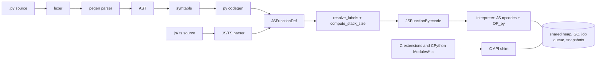

# Python on dquickts: plan

## Status (2026-11-02)

| Milestone | Status |
|---|---|
| M0 harness | Done: `make testpy`, `testpy-l3b`, `testpy-l3c`, `testpy-ast`, `testpy-replay`, `testpy-golden`; expected-failure files committed |
| M1 parser | Done: L2 identical on 100% of `Lib/**/*.py` |
| M2 core | Done: L0 207/211 golden scripts (the 4 failures are the UTF-16 surrogate deviation, §8) |
| M3 stdlib + C API | Done: L3a 4563/4617 test ids; L1 replay parity 99.9% on self-contained cells and 99.9% on sessions; omp `prelude.py` imports and runs (`tests/py/omp_prelude_check.py`) |
| M4 snapshots, JS interop, rquickjs | Done: interop suite, `--drepl --python` (C module state included, `make test-snapshot-capi`), rquickjs `eval_python` |
| M5 abi3, threads | Done: 13 abi3 wheels pass their smoke tests (`tests/py/abi3/run.sh`); OS threads under a GIL (`tests/py/threads`, `test_threading` in L3) |
| M6 tracing, performance | Done: `sys.settrace`/`setprofile` (pdb, trace, cProfile), tracemalloc, frozen modules, base snapshot startup about 1.0x CPython, `make bench-py` geomean about 1.48x CPython |
| M7 source builds, L3b/L3c | Done: numpy `test_multiarray` 99.99% plus `test_umath`, `test_numeric`, `test_linalg`, `test_random` (`tools/build_numpy.sh`); Pillow 719 passed (`tools/build_pillow.sh -t`); L3b about 9047/9082, L3c 14087/14155 |

Remaining deviations (listed per test id in `tests/py/l0_errors.txt` and
`tests/py/cpython_errors.txt`, 152 L3 ids):

- `str` is UTF-16: a surrogate pair written as two lone surrogates reads as one astral character
  (§8).
- C modules are bound to one runtime of the process at a time; no subinterpreters,
  per-interpreter GIL or multi-phase-init isolation checks; no free-threaded ABI.
- VM internals with no QuickJS equivalent: inline values and `__dict__` layout
  (`test_class.TestInlineValues`), writes through frame `f_locals`, generator/frame internals
  (`gi_code` reuse, frame clearing), `sys.monitoring` events (not delivered), and
  `co_code` beyond the stream synthesized from the QuickJS bytecode (`replace(co_code=...)`
  only accepts that stream; the runtime cannot execute CPython bytecode).
- `__del__`/`tp_finalize` of objects in garbage cycles and weakref callbacks during cycle
  resurrection; refleak checks.
- Lone surrogates in the UTF-8/16/32 codecs (same UTF-16 cause); `locale`-aware `int`/`float`
  formatting; `gc` generations and `DEBUG_SAVEALL`; a few `os` (fork at finalization, invalid
  fds, `utime` with `Decimal`/`Fraction`) and `ast` (`__replace__` of custom fields) cases; the
  `test_concurrent_futures` modules.
- Statically linked C modules: in `sys.builtin_module_names`, no `__file__`.
- Code objects are QuickJS bytecode: `.pyc` files are not interchangeable with CPython's
  (`cache_tag` `quickpy-315`); `cp315` binaries are rejected.

Goal: run CPython 3.15 code on the QuickJS VM by compiling Python to QuickJS bytecode. Python
and JS/TS share one runtime: heap, GC, job queue, module graph and snapshot format. C extensions
load through a CPython-compatible C API.

Non-goals: binary compatibility with version-specific wheels (`cp315-*`), free-threading,
`.pyc`/CPython-bytecode compatibility, `dis` output parity, `sys.settrace`-based tooling
(debuggers, coverage) before M6.

## 0. Workload facts that set the priorities

Source: 91,765 unique Python cells run through the omp eval kernel, read from `~/.omp/stats.db`
(2026-01-18 to 2026-10-30). "% cells" = share of cells using the feature at least once.

| Fact | Value |
|---|---|
| Cells using only core syntax (no class, decorator, `yield`, `async def`, `global`/`nonlocal`, walrus, `*args`/`**kw`) | 95.1% |
| Python semantics no JS opcode provides: keyword args / slicing / truthiness / `in` / `d[k] =` | 41.2 / 35.9 / 25.9 / 23.9 / 10.3% |
| Cells runnable with builtins + prelude only | 50.5% |
| + subprocess, pathlib, collections, re, json, os | 76.3% |
| + 24 more modules (30 total, including numpy, PIL and arc3) | 93.5% |
| Cells needing third-party C extensions (numpy, PIL, yaml, arc3, …) | ~10% |
| Cells reading names defined by earlier cells (durable kernel state) | 60.1% |
| `class` / generators / `match` | 0.7% / 0.16% / 0% |

Order of work follows these numbers: core syntax and builtin-type semantics first, then the
module set from the coverage table, then C extensions.

## 1. Architecture

Sources are built as one unit, the same way `quickjs-snapshot.c` is included at the end of
`quickjs.c`. That gives them the internal structs without exporting them:

| File | Content |
|---|---|
| `quickpy-lexer.c` | tokenizer, ported from CPython `Parser/lexer` (indentation, PEP 701 f-strings, t-strings) |
| `quickpy-parser.c` | generated from CPython `Grammar/python.gram` by CPython's pegen with our action helpers; checked in, regenerated by `make py-regen` |
| `quickpy-ast.h/.c` | AST node types generated from `Parser/Python.asdl` |
| `quickpy-compile.c` | symtable and codegen into `JSFunctionDef` |
| `quickpy-opcode.h` | `PYDEF(id, size, n_pop, n_push, fmt)` table of `OP_py` subops |
| `quickpy-*.c` | builtin types, `builtins`, `sys`, import system |
| `capi/` | `Python.h`, the libpython symbols, compat headers for CPython's private API |
| `pylib/` | vendored stdlib subset from a pinned CPython 3.15 tag (sync script records the commit) |

Front ends: `qjs` picks Python from the `.py` extension or `--python`, the same way it picks TS.
`qpy` is a launcher with CPython's command line (`-c`, `-m`, `-u`, `-X`, `-I`). CPython's tests
spawn `sys.executable` with those flags. `qjs --drepl FILE --python` is the durable Python REPL.
The stdlib is frozen into a base snapshot built at build time and embedded in the binary. Bases
are reproducible, so startup reads a snapshot instead of compiling modules. CPython's frozen
modules (importlib's bootstrap, zipimport, the startup and `runpy` modules, `__hello__` and
`__phello__`; `_imp.find_frozen`, `FrozenImporter`, `-X frozen_modules`) are their marshalled
QuickJS bytecode, also written at build time and embedded next to the base (python/frozen.c);
the base is made with them.

## 2. Decision D1: test suite

Yes, use CPython's `Lib/test` as the conformance suite. But it can only run once `unittest`
runs, and `unittest` pulls in `traceback`, `inspect` → `dis`, `re`, `difflib`, `pprint`,
`warnings` and `argparse`. So it is layer 3 of 4:

| Layer | What | Oracle | Available from |
|---|---|---|---|
| L0 golden | `tests/py/*.py`, small scripts printing results, one per feature in §0 | `.out` files generated by host CPython 3.15 (`make testpy-golden`) | M2 |
| L1 corpus differential | omp kernel sessions replayed cell by cell in `qpy` and CPython side by side; stdout, exception type and display value compared | live CPython run in the same sandbox | M3 |
| L2 parser differential | `ast.dump(..., include_attributes=True)` from our parser vs CPython on `Lib/**/*.py` and all corpus cells | CPython `ast` | M1 |
| L3 CPython `Lib/test` | real `unittest`, `test.support` trimmed by `tests/cpython.patch` | expected-failure list per test id | M3 |

- L1 sizing: 4,602 sessions (21,309 cells) need no third-party module, no file writes and no
  agent/tool calls. Counting the replayable prefixes of all sessions gives 31,370 cells (30%).
  Only 1,921 cells are self-contained and side-effect free, so the replay has to keep session
  state. Writes and subprocesses run in a scratch directory under `sandbox-exec`. The corpus is
  private: `tests/py/corpus.py` extracts it to a local cache, and only that tool is committed.
- L3 workflow copies test262: `make testpy-bootstrap` clones CPython at the pinned tag and
  applies `tests/cpython.patch`. `cpython.conf` lists the modules. `cpython_errors.txt` holds
  the expected failures by test id (`test_dict.DictTest.test_copy`). `make testpy` reports
  regressions and new passes, and `make testpy-update` rewrites the list. The orchestrator
  (`tests/py/run.py`, run by host CPython) starts one `qpy` per test module with a timeout. A
  reporter module writes JSON lines per test, so a crash costs one module, not the run.
- L3a, the language core, comes first: `test_grammar, test_syntax, test_scope, test_exceptions,
  test_raise, test_int, test_long, test_float, test_bool, test_complex, test_str, test_bytes,
  test_list, test_tuple, test_dict, test_set, test_unpack, test_unpack_ex, test_augassign,
  test_compare, test_contains, test_iter, test_generators, test_genexps, test_listcomps,
  test_fstring, test_format, test_class, test_descr, test_super, test_with,
  test_keywordonlyarg, test_extcall, test_positional_only_arg, test_types, test_builtin,
  test_print, test_sort, test_enumerate, test_range, test_slice, test_coroutines,
  test_string_literals, test_dataclasses, test_enum`. Several of these are doctests, so
  `doctest` (and `pdb` import-only) are L3a prerequisites.
- L3b covers the stdlib in corpus order: `test_pathlib, test_subprocess, test_json, test_re,
  test_collections, test_os, test_shutil, test_glob, test_time, test_struct, test_difflib,
  test_ast, test_textwrap, test_tempfile, test_hashlib, test_sqlite3, test_datetime,
  test_urllib*, test_concurrent_futures, test_statistics, test_asyncio`.
- L3c extends L3 to more stdlib modules, grouped by area in the `[l3c]` section of
  `tests/py/cpython.conf` (`make testpy-l3c`).
- Fuzzing: `fuzz_py_compile` next to the existing `fuzz_compile`.
- Benchmarks: pyperformance pure-Python subset (nbody, richards, chaos, float, deltablue,
  raytrace, go, spectral_norm, unpack_sequence, generators, coroutines, json_dumps/loads,
  regex_v8) plus L1 replay wall time.

## 3. Decision D2: bytecode expansion

Facts from the code:
- `quickjs-opcode.h` defines 250 runtime opcodes, including the short ones, so `OP_COUNT` = 250.
  The dispatch table sends `[OP_COUNT ... 255]` to `case_default`. That leaves 6 free one-byte
  slots.
- `JSFunctionBytecode` has 10 spare flag bits ("XXX: 10 bits available").
- `emit_op()` only needs `s->cur_func`, and `new_label_fd()` already takes a `JSFunctionDef`.
- `js_create_function()` runs scope linkage, `resolve_variables`, `resolve_labels` and
  `compute_stack_size`.
- Bytecode float constants are read back with `__JS_NewFloat64` and keep their tag.

Decision: a hybrid.

1. Opcodes whose meaning doesn't depend on value types are reused as they are: stack ops
   (`drop`, `dup`, `swap`, `rot*`, `nip*`), constants (`push_i32`, `push_const`, `undefined`,
   `push_true`/`push_false`), locals and closures (`get_loc`/`put_loc`/`set_loc`, `get_arg`,
   `get_var_ref`/`put_var_ref`, `close_loc`, `get_loc_check` for `UnboundLocalError`), control
   flow (`goto`, `if_false`/`if_true` only after an op that pushes a real bool), exceptions
   (`catch`, `nip_catch`, `gosub`/`ret`, `throw`), `fclosure`, positional `call`/`call_method`/
   `tail_call`, `return`/`return_undef`, `initial_yield`/`yield`, `array_from` (a list is an
   Array, see D3), `strict_eq` and `is_undefined_or_null` (`is`, `is None`), `line_num`.
2. Every operation with Python semantics goes behind one prefix opcode: `OP_py <u8 subop>
   <operands>`. The interpreter has a second computed-goto table. About 70 subops:
   - operators: `binop <op>` (all 13 binary ops and their in-place forms), `unop`, `compare <op>`,
     `contains`, `to_bool`, `jump_if_false/true <label>`
   - subscript: `getitem`, `setitem`, `delitem`, `getslice`, `setslice`, `build_slice`
   - attributes: `getattr <atom> <ic>`, `setattr`, `delattr`, `load_method <atom> <ic>`
     (no bound-method allocation for `s.split()`)
   - names: `load_global <atom> <ic>`, `store_global`, `del_global`, `load_name`/`store_name`/
     `del_name` (class bodies, `exec` with a namespace)
   - calls: `call_kw <argc> <kwnames const>`, `call_ex` (star args)
   - building: `build_tuple`, `build_dict`, `build_set`, `list_extend`, `dict_update`,
     `dict_merge`, `set_update`, `unpack_seq <n>`, `unpack_ex <before> <after>`
   - strings: `format_value <conv>`, `build_string <n>`
   - iteration: `get_iter`, `for_iter <label>` (fast paths for list/tuple/range/dict, no
     `{value, done}` allocation), `send` (`yield from`/`await`)
   - exceptions: `exc_match`, `push_exc_info`/`pop_exc_info`, `raise <kind>`, `reraise`
   - `with`: `with_enter`, `with_exit`
   - functions and classes: `make_function <flags>` (defaults, kw-defaults, annotations,
     `__class__` cell), `load_build_class`
   - imports: `import_name`, `import_from`, `import_star`
   - REPL: `print_expr` (calls `sys.displayhook`; 12.7% of cells end in a bare expression)
   - later, because the corpus has none: `match_class`, `match_mapping`, `match_sequence`,
     `match_keys`
3. The remaining 5 one-byte slots go to the hottest subops, picked by profiling the L1 replay.
   Candidates: `jump_if_false`, `load_method`, `binop`, `getitem`, `load_global`.

Compiler pipeline:
- Python decides scope statically, so the symtable resolves locals, cells, free variables,
  globals and class scopes. Codegen then emits final variable ops, and the py path of
  `js_create_function` skips `resolve_variables`. `resolve_labels` and `compute_stack_size` are
  reused. Every bytecode walker learns the subop table: stack size, label resolution, the
  writer/reader atom fixups, freeing, the dumper, the snapshot writer and reader.
- The JS peepholes in `resolve_labels` get audited for the reused opcodes. Example: fusing
  `lnot` + `if_false` is only valid after `py_to_bool`.
- New `is_py` bit in `JSFunctionBytecode`. Error paths shared with JS check it, e.g. so
  `get_loc_check` raises `UnboundLocalError` instead of `ReferenceError`.
- Inline caches: `<ic>` operands index a per-function cache array, keyed by shape uid + type
  version tag (attributes) or dict version (globals). Like CPython's, they hold no references,
  so they never extend the life of an object or class; the type keeps the instance shape last
  cached (CPython: the type owns its instances' shared keys). Snapshots save the caches as empty.

Calling convention, vectorcall style: `argv` holds the positional values, then the keyword
values. The kwnames tuple travels in the `new_target` slot under a new `JS_CALL_FLAG_PY_KW`.
Python calls are never JS `new` calls, so that slot is free.
- A Python callee binds arguments in C at frame setup: defaults from the function object,
  `*args`, `**kwargs`, keyword-only arguments. The fast path is `argc == co_argcount` with no
  kwnames.
- A JS callee gets the keywords as a trailing plain object.
- A C-API `METH_FASTCALL | METH_KEYWORDS` callee gets `(args, nargs, kwnames)` with no copying.
- The `OP_py` call subops support `JS_RequestSuspend()` the way `OP_call` does, so a running
  Python cell can be suspended and snapshotted.

Language mapping:
- Generators and coroutines run on the QJS generator machinery, which starts lazily like Python.
  `async def` does **not** become a QJS async function, because those start eagerly and are
  built on promises. `await x` compiles to `send` on `x.__await__()`. asyncio gets an event loop
  class over the QJS job queue and quickjs-libc timers/fd handlers. A cell with top-level
  `await` compiles as a coroutine and the kernel drives it.
- Comprehensions are inlined (PEP 709 style) with renamed iteration variables. Loop variables
  live at function level, so no per-iteration `close_loc` (Python closures bind late).
- Exceptions capture `(function, pc)` pairs when thrown. Traceback objects are built from them
  on demand, not from a formatted string.
- `__code__` is a facade over `JSFunctionBytecode` (`co_argcount`, `co_varnames`, `co_flags`,
  `co_firstlineno`, `co_qualname`, …) so `inspect.signature` and `dataclasses` work.
  `co_code`, `co_linetable` and `co_exceptiontable` are a CPython 3.15 instruction stream
  synthesized from the bytecode (one group of CPython instructions per QuickJS instruction,
  python/codeobject.c), so the stock `dis`, `inspect.getclosurevars` and `co_lines()`-based
  tools work; `f_lasti`/`tb_lasti`/`co_positions()` offsets are offsets in it. The runtime
  cannot execute CPython bytecode: `replace(co_code=...)` only accepts the synthesized stream.

## 4. Decision D3: sharing between JS and Python

Principle: one `JSRuntime`, one heap. Values are shared by identity. Nothing is converted
implicitly, except numbers at call boundaries.

| Python | Representation | What JS sees |
|---|---|---|
| `None` | `JS_UNDEFINED`; JS `null` also reads as `None` (`is` / `==` / hash treat both as `None`) | `undefined` |
| `bool` | `JS_TAG_BOOL`; Python ops treat it as `int` | boolean |
| `int` | `JS_TAG_INT` → `JS_TAG_SHORT_BIG_INT` → BigInt; overflow promotes to bigint, not float | number (int32) or bigint |
| `float` | always `JS_TAG_FLOAT64`, created with `__JS_NewFloat64` | number |
| `str` | `JSString` (8/16-bit; ropes flattened before indexing) | string |
| `list` | `JS_CLASS_ARRAY` fast array | the same Array |
| `bytes` / `bytearray` | own classes over an immutable / resizable `ArrayBuffer` | typed-array views over the same memory |
| `memoryview` | JS TypedArray / DataView | the same object |
| function | `JS_CLASS_BYTECODE_FUNCTION` with `is_py` | callable |
| JS object / Map / Promise | unchanged | Python sees `js.Object` (attributes and items), a mapping, an awaitable |

- **Numbers at call boundaries.** Python → JS: an int outside int32 but within ±2^53 is passed
  as a Number. JS → Python: an integral float64 returned by a JS function becomes `int`. Values
  stored inside shared containers are never rewritten.
- **Why this `None`.** Implicit `return`, missing arguments and void JS callbacks all produce
  `undefined`, and the `undefined`/`return_undef`/`is_undefined_or_null` opcodes are reused.
  Reading `null` as `None` keeps `JSON.parse` output usable from Python without conversion.
- **Attribute protocol.** Python `o.x` on a JS object does a JS `[[Get]]` and raises
  `AttributeError` if the property is missing. JS `o.x` on a Python object goes through exotic
  `get_property` handlers to Python `getattr`, and `AttributeError` becomes `undefined`. A dict
  needs no Map facade: `d.get(k)` from JS is `dict.get`. Python objects expose
  `Symbol.iterator` and `toJSON`. Deep copies are explicit (`to_js()` / `toPy()`).
- **Exceptions.** A JS throw caught in Python is `js.JsError(Exception)` holding the JS value. A
  Python exception escaping into JS is thrown unchanged, so identity survives a round trip.
- **Async.** A JS Promise is awaitable in Python. A Python coroutine is a thenable in JS, and
  calling `then` schedules it as a Task.
- **Modules.** ES modules can import `.py` files through the loader. The result is a synthetic
  module whose named exports are the public globals after execution, plus `default` = the module
  object. Python reaches JS through `import js` (globalThis) and `js.import_module(spec)`, which
  is synchronous unless the module uses top-level await.
- **GC.** QuickJS's cycle collector uses trial deletion, like CPython's, so cycles that cross
  languages are collected. Two-runtime bridges such as Pyodide can't collect them. Every Python
  class implements `gc_mark`.
- **Snapshots.** Every new class gets snapshot write/read cases. Files, sockets and processes
  are host state: `JS_WriteSnapshot()` fails with its existing TypeError.
  C-extension objects persist through the existing `save_opaque`/`load_opaque` hooks using
  `__reduce_ex__`, and their modules are re-imported on load; module state dicts shown in the
  namespace (`_csv._dialects`) get their saved entries back. Threads other than the main thread
  are host state; what names the main thread (`_ThreadHandle`, a held `RLock`,
  `threading._main_thread`/`_active`) is bound to the reading process's main thread.

## 5. Decision D4: new primitives

New class IDs are appended to the `JS_CLASS_*` enum. That changes the snapshot signature, which
hashes `JS_CLASS_INIT_COUNT`; that is expected.

| Class | Representation | Notes |
|---|---|---|
| `PY_TUPLE` | inline `JSValue[]`, cached hash | JS sees a frozen array-like |
| `PY_DICT` | compact ordered dict (indices + entries, CPython's algorithm), version tag | str-key fast path |
| `PY_SET`, `PY_FROZENSET` | same table without values | |
| `PY_BYTES`, `PY_BYTEARRAY` | own an `ArrayBuffer` (`immutable` / `max_byte_length`) | `byte_length` is `int`: 2 GiB limit |
| `PY_TYPE` | MRO tuple, dict, **slot table** (`tp_*` / `nb_*` / `sq_*` / `mp_*` function pointers), version tag | one dispatch path for Python classes, builtin types and C-API types |
| `PY_OBJECT` | instance attributes in QJS shapes; `__dict__` materialized on demand | shapes give the attribute ICs |
| `PY_METHOD`, `PY_CLASSMETHOD`, `PY_STATICMETHOD`, `PY_PROPERTY`, `PY_SUPER` | descriptor protocol | |
| `PY_MODULE` | globals `PY_DICT` | function objects carry `__globals__` |
| `PY_GENERATOR`, `PY_COROUTINE`, `PY_ASYNC_GEN` | wrap QJS generator state | `send` / `throw` / `close` with `GeneratorExit` |
| `PY_RANGE`, `PY_SLICE`, `PY_COMPLEX`, `PY_CELL`, `PY_CODE`, `PY_FRAME`, `PY_TRACEBACK` | small | `PY_CELL` wraps a `JSVarRef` for `__closure__`; frames and tracebacks are lazy |
| iterators and views | list/tuple/dict/set iterators, `dict_keys`/`items`/`values` | |
| `PY_NATIVE` | JS companion of a C-extension object | see D5 |
| singletons | `NotImplemented`, `Ellipsis` | |

Infrastructure:
- **str.** Hash cached in `JSString`'s unused `hash` bits for non-atoms. Strings with surrogate
  pairs get a lazily built UCS4 side buffer. It gives code-point indexing for `len`, slicing and
  `[i]`, and it is also what the C API hands out for `PyUnicode_KIND() == 4`.
- **Ported from CPython** (PSF-2.0; notice goes in `LICENSE`):
  - `Objects/stringlib` (find/split/replace templates over UCS1/UCS2/UCS4, i.e. JSString data)
  - timsort (`list.sort`)
  - the compact dict
  - `formatter_unicode` (format specs: `2d`, `.1f`, `>8`, `,`, `#x`, …)
  - float repr rules on top of `dtoa.c`
  - numeric hash modulo 2^61−1, so `1 == 1.0 == True` hash equally
- **Bitwise ops on big ints** reuse QJS BigInt, which has the same infinite two's-complement
  semantics as Python.

## 6. Decision D5: C extensions

Facts:
- From the limited API 3.12 on, `Py_INCREF`/`Py_DECREF` are function calls.
- `abi3t` ([PEP 803](https://peps.python.org/pep-0803/), Final, Python 3.15) makes `PyObject`,
  `PyVarObject` and `PyModuleDef` opaque. Instance data goes through `PyObject_GetTypeData`
  (PEP 697) and modules through PEP 793. Extensions can't touch object layout at all.
- Plain `abi3` still embeds `PyObject_HEAD`, and older limited versions read
  `ob_refcnt`/`ob_type` inline.
- GraalPy compiles CPython's own `_sre` as `_cpython_sre` through its C API layer.

Decision: a cpyext-style mirror model, with two compatibility tiers.

- **Handles.** A managed value (str, int, list, a Python instance, …) handed to C becomes a
  mirror `{Py_ssize_t ob_refcnt; PyTypeObject *ob_type; JSValue v}`. It is created on the first
  crossing and cached per object. It lives while C holds references or the JS object is alive,
  so borrowed references stay valid as long as their owner. Singletons, small ints and builtin
  types have static mirrors.
- **Reference counts seen by C** follow CPython 3.14+. `Py_REFCNT` of an object bound to a JS
  value adds the JS references to `ob_refcnt`. During a C method call it leaves out the
  references CPython borrows: the bridge's own references to self and the arguments
  (vectorcall), and the caller's operand-stack copy of a value that a local of the calling frame
  holds (`LOAD_FAST_BORROW`). So `a.resize(n)` on a function local is uniquely referenced, as
  numpy's refcheck expects.
- **Extension-type instances** are C allocations: a CPython header plus `tp_basicsize` payload,
  with a `PY_NATIVE` JS companion. `tp_traverse` feeds the QJS cycle collector.
- **Tier S (source): our `Python.h`** covers the full non-limited API. Macros that read
  builtin-type internals (`PyTuple_GET_ITEM`, `PyList_GET_ITEM`, `PyUnicode_DATA`,
  `PyBytes_AS_STRING`) become functions. `PyTypeObject` keeps CPython 3.15's field order so
  static type definitions compile, and `PyType_Ready` converts them to `PY_TYPE`.
  - Its first consumer is CPython's own `Modules/*.c`. The stdlib accelerators come from there
    instead of hand ports: `_sre, itertools, _collections, _functools, _struct, math, cmath,
    _json, _datetime, binascii, zlib, _bisect, _heapq, _random, unicodedata, array, select,
    _socket, _posixsubprocess, _sha2/_md5/_blake2, _csv, _sqlite3, pyexpat, _ssl`.
  - The private API they use (Argument Clinic `_PyArg_*`, `pycore_*` headers) gets shims in
    `capi/compat`.
  - Build: `tools/capi_sync.py` vendors `Include/` into `capi/include`, the layout-independent
    `pycore_*` headers into `capi/compat` and the modules listed in `capi/Setup.qp` (with their
    clinic files, `_hacl/`, `expat/`) into `capi/modules`, each area patched by its `PATCHES`
    (`--check` verifies, `--record` captures local edits). With `CONFIG_PYTHON_CAPI=y` (64-bit
    POSIX) the modules are compiled as separate translation units (`make capi-modules`). The
    self-contained ones are part of the engine library (linked with `quickjs.o`, archived in
    `libquickjs.a`) and registered by the runtime itself (`qp_state_init`), so every embedder
    has them; the ones that link a system library (zlib, bz2, lzma, zstd, sqlite3, OpenSSL,
    libffi, readline/libedit, libuuid; `*external*` in `Setup.qp`) are archived in
    `libqpcapi.a`, which `qpy` and `qjs` link and register with
    `PyImport_ExtendInittab(_PyQp_ExtInittab)`; rquickjs builds them under `python-*` cargo
    features. The system libraries are optional pkg-config dependencies
    (`CONFIG_PYTHON_CAPI_NO_*`). `_decimal` uses the bundled libmpdec. Not built:
    `_interpreters`/`_interpchannels`/`_interpqueues` (one interpreter, no PEP 684
    subinterpreters) and the test-only modules.
- **Tier B (binary).** Load unmodified `*.abi3.so` and `*.abi3t.so`: export every stable ABI
  symbol (`Misc/stable_abi.toml`), `dlopen`, then `PyInit_*` or the PEP 793 export hook. Good
  first targets are PyO3 abi3 wheels (e.g. `cryptography`).
- **Not planned:** version-specific `cp315` binaries, which would need CPython's struct layouts
  for the builtin types plus its internal symbols. numpy and Pillow get built from source
  against Tier S; PyPy and GraalPy both do this.
- **Tier S source builds (M7).** They carry our own ABI tag. `SOABI` is `quickpy-315-<multiarch>`
  and `EXT_SUFFIX` is `.quickpy-315-darwin.so`. That suffix is the first entry of
  `importlib.machinery.EXTENSION_SUFFIXES`, ahead of the abi3 ones.
  - Loading: `python/capi_dynload.c` loads these files without the `Py_mod_abi` stable check.
  - Build settings from `sysconfig`: `INCLUDEPY` is `<prefix>/capi/include` and `LIBPYTHON` is
    `''`. Extensions link with `-undefined dynamic_lookup` (`LDSHARED`/`LDCXXSHARED`) against the
    symbols qpy exports, and there is no libpython.
  - Wheel tag: meson-python and setuptools tag these wheels
    `quickpy315-quickpy_315_<multiarch>-<platform>`. pip's bundled `packaging.tags`, patched by
    `tools/pylib_sync.py`, offers that tag first.
  - Cython: `pyconfig.h` defines `CYTHON_LIMITED_API`. Cython's CPython mode writes
    `PyListObject.ob_item`, `tstate->current_exception` and frame structs directly, and none of
    those exist here.
  - numpy recipe: `tools/build_numpy.sh`. pip and meson-python run under qpy, so meson's python
    introspection queries qpy. Meson itself (`MESON=` wrapper), Cython and ninja run on the
    host python3.15, because they only configure and generate code.
  - numpy 2.5.4 test subset under qpy (`NUMPY_TESTS=1`; pytest 9.2.0, hypothesis 6.170.14),
    against CPython 3.15 with the PyPI wheel on the same machine:

    | file | qpy | CPython 3.15 |
    |---|---|---|
    | `_core/tests/test_multiarray.py` | 14273 passed, 6 skipped, 1 failed (99.99%) | 14276 passed, 4 skipped |
    | `_core/tests/test_umath.py` | 4683 passed, 75 skipped, 13 xfailed (100%) | 4683 passed, 75 skipped, 13 xfailed |
    | `_core/tests/test_numeric.py` | 1706 passed, 1 skipped, 1 xfailed (100%) | 1706 passed, 1 skipped, 1 xfailed |
    | `linalg/tests/test_linalg.py` | 502 passed, 2 skipped, 1 xfailed (100%) | 503 passed, 2 skipped |
    | `random/tests/test_random.py` | 142 passed (100%) | 142 passed |
    The linalg xfail (`test_blas64_geqrf_lwork_smoketest`) is build configuration: the source
    build uses the system BLAS/LAPACK, the PyPI wheel 64-bit OpenBLAS. In test_multiarray, the
    failure is `TestCreation::test_tracemalloc`: `tracemalloc.start()` raises because the
    runtime does not trace its allocations (`capi/compat/qp_internals.c`). The two extra skips
    need CPython's test-only `_testbuffer` and `_interpreters` modules, which qpy does not build.
    The four skips that CPython also has are BLAS FPE support, pickle protocol 5, and two
    huge-memory dot tests.
  - Pillow 13.0.0 subset (`tools/build_pillow.sh -t`): 719 passed, 4 skipped, 1 xfailed. All
    skips are upstream conditions.
  - matplotlib recipe: `tools/build_matplotlib.sh`. It builds numpy and Pillow with the two
    recipes above, then kiwisolver 1.5.1 (setuptools, cppy), contourpy 1.4.0 and matplotlib
    3.11.2 (meson-python, pybind11) from their sdists. Every build tool runs under qpy: pip,
    meson with its subproject downloads (FreeType, HarfBuzz, libraqm, SheenBidi, Qhull, bundled
    as in the PyPI wheels), setuptools. pybind11 makes its types with `tp_alloc` of a metatype
    and `PyType_Ready`, so `PyType_Ready` of such a heap type binds it like a `PyType_FromSpec`
    type.
  - `tests/py/mpl/run.sh [-t]` runs `tests/py/mpl/demo.py` (Agg 2x2 figure, mathtext, contour,
    tight and constrained layout, PNG/SVG/PDF) under qpy and under CPython 3.15 with the PyPI
    wheels of the same versions. The stdout matches and the PNGs are pixel-identical. The SVG
    and PDF bytes differ only in their zlib streams: qpy links Homebrew zlib 1.3.2, while the
    Pillow wheel uses zlib-ng and CPython uses the system zlib 1.2.12. The demo therefore hashes
    the decoded images and the decompressed streams. With `-t`, matplotlib's own tests give the
    same counts under qpy and CPython: test_figure 155 passed/5 skipped, test_axes 890/35,
    test_colors 324/1, test_contour 89/2, test_text 117/16, test_mathtext 1127/539, test_agg
    20, test_backend_svg 28/20. The skips are missing Inkscape/Ghostscript and similar upstream
    conditions.
- **Our own modules** (not taken from CPython): `builtins, sys, posix` (over quickjs-libc and
  libc), `time, _thread, _weakref` (QJS WeakRef), `gc, _imp, marshal` (data only), `_ast,
  _tokenize, _opcode`/`dis`, `_contextvars, atexit, _signal, errno, _stat`. `_io` starts as
  CPython's pure-Python `_pyio`.
- **Threads.** The GIL is a mutex around the runtime. `Py_BEGIN/END_ALLOW_THREADS` release it,
  and `PyGILState_Ensure` from a foreign thread waits for it. The QJS stack limit is swapped on
  handoff. `threading` arrives with this; the corpus uses `ThreadPoolExecutor` in 0.4% of cells.

## 7. Milestones

| M | Scope | Exit criteria |
|---|---|---|
| M0 | Harness: `tests/py/run.py`, golden generator, AST differential, corpus extractor, `testpy-bootstrap` | `make testpy` runs; expected-failure files committed |
| M1 | Lexer, pegen parser, AST, symtable, `_ast` | L2: identical dumps on 100% of `Lib/**/*.py` (excluding intentional `badsyntax_*`) and ≥99.9% of corpus cells; SyntaxError type and line match on `test_syntax` cases |
| M2 | `OP_py`, codegen, builtin types (D4), builtins, exceptions, closures, generators, classes, descriptors, `super` | L0 green, covering every feature row in §0; pure pyperformance benchmarks run |
| M3 | Import system, `pylib/`, own modules, C API Tier S core, CPython `Modules/*.c` from the D5 list, `unittest` | L3a ≥90% of test ids pass; L1 self-contained cells ≥95% parity; L1 session replay ≥90% parity; omp `prelude.py` imports and runs |
| M4 | JS interop (D3), snapshots for every new class, `--drepl --python`, rquickjs `eval_python` | interop suite green; snapshot round-trip test per class in `tests/snapshot`; a cycle crossing languages gets collected |
| M5 | Tier B loader, `pip install` of pure and abi3/abi3t wheels, `_ssl`, GIL and `threading` | 10 named abi3 wheels import and pass their smoke tests; `test_threading` subset |
| M6 | omp integration: route eval py to dquickts when a cell's imports are covered, CPython fallback otherwise; tracing hooks | L1 replay parity ≥98%; startup from base snapshot measured; within 2× CPython 3.15 on the benchmark set |
| M7 | Source builds of numpy and Pillow on Tier S; L3b | numpy and Pillow test subsets; L3b pass rates tracked |

## 8. Risks

- **The C API is the long pole**; PyPy's cpyext took years. Scope it to what CPython's own
  modules and abi3 need, measured by L3, not by API-surface counts.
- **Float-ness can leak away.** Any QJS helper that calls `JS_NewFloat64` on a Python float
  turns `2.0` into int `2`. Python paths must never route floats through JS number helpers;
  audit, and cover with L0 cases (`print(4/2)`).
- **str and UTF-16.** A surrogate pair can't be told apart from two lone surrogates (Python
  treats those as two characters). Documented deviation.
- **Dispatch cost.** `OP_py` adds one dispatch per Python op; the spare slots and inline caches
  offset it. Measured from M2 on.
- **Single-threaded heap.** Python code that expects real parallel threads gets GIL behaviour.
  Same as CPython with the GIL, but this applies to JS code on the runtime too.
- **CPython drift.** Grammar, AST and stdlib are pinned to one 3.15.x tag. A version bump means:
  regenerate the parser, resync `pylib/`, re-run L2 and L3.
- **Licensing.** Vendored and ported CPython code is PSF-2.0; add notices.
